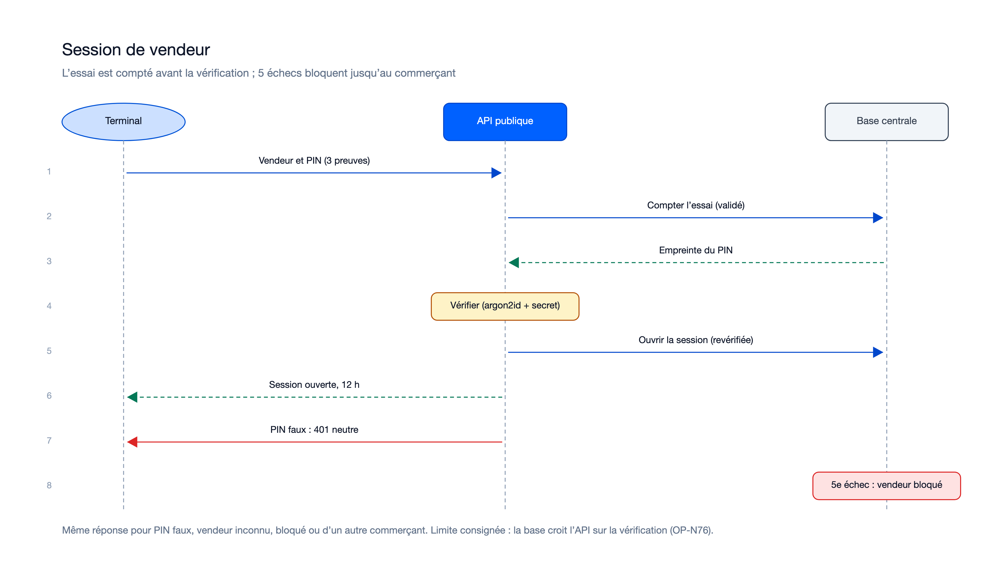
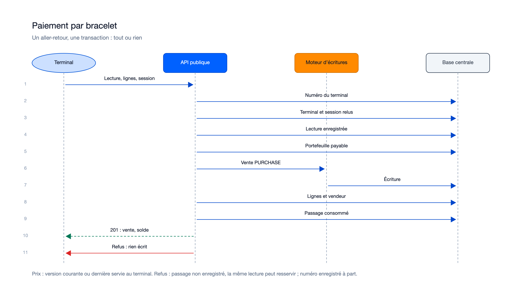
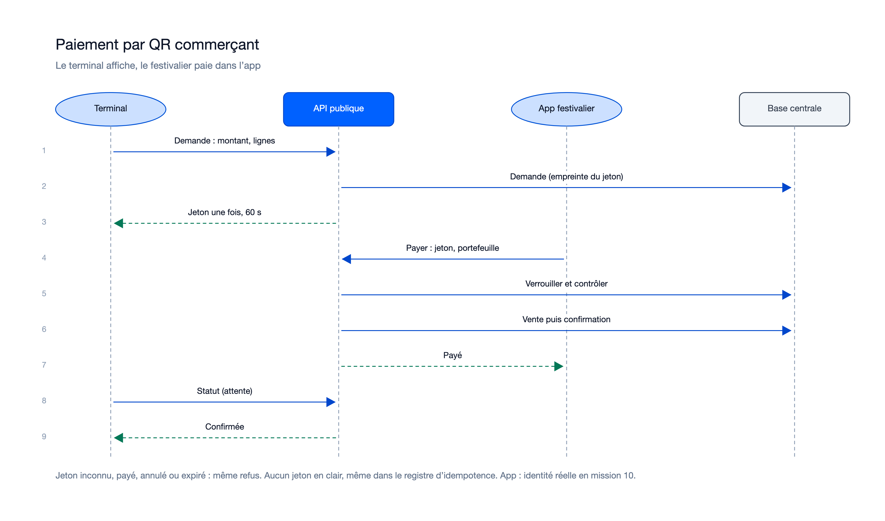

# Séquences — mission terminaux-paiement-en-ligne-01M52QB9

> État : **planifiée** (plan finalisé le 22/10/2026). Diagrammes tirés du plan et des contrats
> (`contracts/vendors.md`, `payments.md`, `qr-payments.md`) ; à refaire d'après le code livré.

## Flux internes propres à cette mission

### Session de vendeur

Sources : [`sequence-session-vendeur.excalidraw`](diagrams/sequence-session-vendeur.excalidraw), [`sequence-session-vendeur.svg`](diagrams/sequence-session-vendeur.svg).

### Paiement par bracelet

Sources : [`sequence-paiement-bracelet.excalidraw`](diagrams/sequence-paiement-bracelet.excalidraw), [`sequence-paiement-bracelet.svg`](diagrams/sequence-paiement-bracelet.svg).

### Annulation d'une vente

Sources : [`sequence-annulation.excalidraw`](diagrams/sequence-annulation.excalidraw), [`sequence-annulation.svg`](diagrams/sequence-annulation.svg).

### Paiement par QR commerçant

Sources : [`sequence-qr-commercant.excalidraw`](diagrams/sequence-qr-commercant.excalidraw), [`sequence-qr-commercant.svg`](diagrams/sequence-qr-commercant.svg).

Le QR client suit le même schéma à l'envers : l'app crée le jeton, le terminal le présente dans `POST /payments`, et
la base verrouille, puis le moteur écrit, puis la base confirme (contracts/qr-payments.md).

Régénération : `python3.14 diagrams/generate.py diagrams ~/.claude/skills/illustre/references/render_excalidraw.py`
(police sans-serif imposée, rendus relus).

## Lien avec la synthèse globale
Contribue à : `docs/05-sequence-diagrams.md` — le paiement en ligne par bracelet y existe déjà (mission 4, lecture
seule) ; il est complété par la vente attribuée au vendeur et l'annulation (flux transverse remonté après les
relectures).

## Nécessaire pour cette mission ? Oui — quatre flux nouveaux entre terminal, API, moteur, base et app.
## Complet ? Oui pour le plan — à refaire d'après le code livré.
## Validé par : Agent, par délégation du porteur (22/10/2026)
