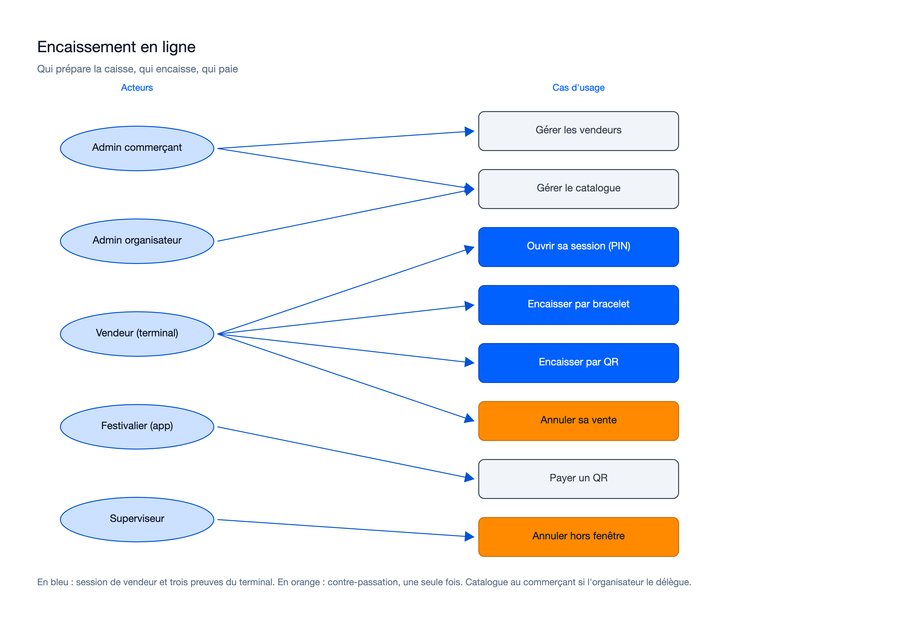

# Cas d'usage — mission terminaux-paiement-en-ligne-01M52QB9

> État : **planifiée** (plan finalisé le 22/10/2026, `640f3eb`). Rédigé au plan ; à recaler après les relectures des
> lots sur le code livré.

## Cas d'usage propres à cette mission

Sources : [`usecase-encaissement.excalidraw`](diagrams/usecase-encaissement.excalidraw), [`usecase-encaissement.svg`](diagrams/usecase-encaissement.svg).

| Cas d'usage | Acteur | Règle principale (prévue au plan) | Route |
|---|---|---|---|
| Gérer les vendeurs | `MERCHANT_ADMIN` (son commerce), `OPERATOR_ADMIN` | PIN de 6 chiffres, empreinte argon2id avec secret hors base ; nouveau PIN = déblocage ; désactivation ferme les sessions | `/merchants/{id}/vendors`, `/vendors/{id}/…` |
| Gérer le catalogue | `ORGANIZER_ADMIN` ; `MERCHANT_ADMIN` si délégué | Prix TTC fixe, taux par article, libellés FR/EN ; chaque modification crée une version immuable | `/points-of-sale/{id}/catalog…` |
| Ouvrir sa session (PIN) | Vendeur, sur le terminal | Essai compté avant la vérification ; 5 échecs bloquent jusqu'au commerçant ; une session par terminal, 12 h ; réponse neutre | `POST /vendor-sessions` |
| Encaisser par bracelet | Vendeur | Un aller-retour, tout ou rien ; lignes au prix de la version courante ou dernière servie ; vente attribuée par la session ; deux temps par `tap_id` | `POST /payments` |
| Encaisser par QR | Vendeur | QR commerçant (jeton 128 bits, 60 s) ou QR client (60 s) ; usage unique garanti par la base ; aucun jeton gardé | `POST /payment-requests`, `POST /payments` |
| Annuler sa vente | Vendeur de la vente | Terminal d'origine, fenêtre de l'événement mesurée à l'heure de la base ; une seule annulation (base) | `POST /payments/{id}/reversal` |
| Payer un QR | Festivalier (app) | Port d'identité du festivalier : faux en test, refusé en production ; réel en mission 10 | `POST /payment-requests/{id}/pay`, `POST /me/customer-qr-tokens` |
| Annuler hors fenêtre | `SUPERVISOR` | Au terminal par jeton sur place (lié à la requête, usage unique) ; au back-office par demande à deux personnes | idem, ou demande `SALE_REVERSAL` |

Hérité de la mission 5a (OP-N74) : l'enrôlement d'une caisse est refusé dès la clôture de l'événement, le guichet
reste possible jusqu'à `CLOSED`. Ce n'est pas un cas d'usage nouveau : il durcit « Émettre un code d'enrôlement » et
« S'enrôler » (domaine « Terminaux »).

Reporté à la mission 10 (décision du porteur au plan) : identification d'un festivalier au guichet.

## Lien avec la synthèse globale
Contribue à : `docs/02-use-case-diagram.md`, domaine « Terminaux et encaissement » (vue terrain : « Encaisser une
vente », « Annuler une vente » ; vue administration : « Gérer vendeurs et catalogue » ; vue festivalier : « Payer par
QR »).

## Nécessaire pour cette mission ? Oui — la mission introduit les vendeurs, le catalogue, le paiement et l'annulation.
## Complet ? Oui pour le plan — à recaler sur le code livré après les relectures.
## Validé par : Agent, par délégation du porteur (22/10/2026)
