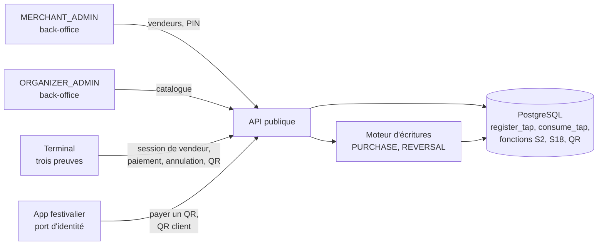

# Implementation Plan: Encaissement en ligne

**Branch**: `feat/terminaux-paiement-en-ligne` | **Date**: 2026-10-22 | **Spec**: [spec.md](spec.md)
**Input**: `kitty-specs/terminaux-paiement-en-ligne-01M52QB9/spec.md`
**Base** : `main` après les PR #4 (mission 5a) et #5 (test SC-007), CI verte (`ea6b668`). Missions
`fondations-grand-livre-01M4AY8M` (moteur d'écritures, `TenantTx`, idempotence), `identite-roles-double-validation-01M4DNDN`
(rôles, demandes d'approbation, approbation sur place, audit), `configuration-parties-evenements-01M4GCJ9` (événements,
participations, points de vente, `terminal_settings`), `bracelets-nfc-01M4TD3W` (`POST /taps`, `TapService`, lecture
embarquée) et `identite-enrolement-terminaux-01M52R6H` (trois preuves, `DeviceGuard`, configuration servie, codes
d'enrôlement, migrations jusqu'à `0030`).

**Contrat de branche** : branche courante, de planification et de fusion `feat/terminaux-paiement-en-ligne`
(`branch_matches_target = true`) ; la mission rejoint ensuite `main` par une PR, comme la 5a.

## Summary

La mission livre l'encaissement en ligne sur les terminaux enrôlés par la 5a.

- **Vendeurs** : un `MERCHANT_ADMIN` crée les vendeurs de son commerce avec un PIN de 6 chiffres. Le serveur garde
  l'empreinte argon2id du PIN, calculée avec un secret hors base (`VENDOR_PIN_SECRET`). Le vendeur ouvre une session sur
  un terminal ; le serveur vérifie le PIN, compte les échecs par vendeur et bloque au 5e jusqu'au déblocage par le
  commerçant. Un terminal porte au plus une session ; le serveur attribue chaque vente à la session ouverte, que le
  terminal désigne par son identifiant (non secret) pour qu'un relais de vendeurs ne se trompe pas de vendeur.
- **Catalogue** : catégories et articles par point de vente, à prix TTC fixe et taux de taxe par article. Chaque
  modification crée une **version immuable** ; la configuration servie porte `catalog.version`. Une ligne de vente est
  acceptée au prix de la version servie à ce terminal ou de la version courante.
- **Paiement par bracelet** : en un aller-retour, dans une seule transaction SQL : statut du terminal relu, lecture
  enregistrée (`register_tap`), vente écrite par le moteur (`PURCHASE`, source `ONLINE`), lignes de vente enregistrées
  par une fonction de la base (somme et prix contrôlés), passage consommé (`consume_tap`). Tout ou rien. Parcours en
  deux temps par `tap_id`.
- **Annulation** : contre-passation totale par le vendeur de la vente, depuis le terminal d'origine, dans la fenêtre
  de l'événement ; au-delà, un `SUPERVISOR` (back-office, ou jeton d'approbation sur place). Une annulation unique est
  **garantie par la base** (index unique sur `reverses_id`, renforcement).
- **QR** : demande de paiement commerçant (jeton 128 bits haché, 60 s) et QR client (12 caractères base32, 60 s),
  écrits et consommés par des fonctions de la base. Le côté festivalier passe par le port d'identité du festivalier
  (faux en test, refusé en production ; réel avec la mission 10, OP-N43 complété).
- **Identification au guichet** : reportée à la mission 10 (décision du porteur au plan) ; la 5b retire seulement à
  l'API les écritures directes dans `kyc_verification` (renforcement).
- **OP-N74** : `create_device_enrollment_code` et `enroll_device` refusent un événement `CLOSED`, et dès `CLOSING` les
  modes `CATALOG_POS` et `KEYPAD_TPE` ; la réaffectation directe d'un terminal par l'API est retirée.



## Technical Context

**Language/Version**: TypeScript 5.9 sur Node.js 22 LTS (API, `engines: >=22 <23`, document 08) ; SQL PostgreSQL 17 (migrations, pgTAP)
**Primary Dependencies**: NestJS 11, `pg`, `jose` (existants) ; nouvelle, épinglée : `argon2@0.44.0` (ranisalt/node-argon2 ; binaires précompilés N-API chargés par `node-gyp-build`, fonctionne avec `ignore-scripts=true`, vérifié sur darwin-x64 ; 0.45 écartée faute de binaire darwin-x64, décision du porteur du 22/10/2026) — examen en R-01
**Storage**: PostgreSQL 17 — schéma de référence inchangé ; migrations `0031` et suivantes (`0028` reste libre) ; `post-roles.sql` (droits par colonne et retraits)
**Testing**: pgTAP (une suite par migration, droits de `cashless_app`, concurrence par verrous), Jest (unitaires ; intégration HTTPS réelle avec le terminal de test et la vraie base ; matrice des preuves étendue aux routes de la mission ; isolation ; secrets ; latence `payment-latency.spec.ts` sautée sous `SKIP_LATENCY`, lancée seule en CI) ; tests en série (base partagée)
**Target Platform**: serveur Linux ; terminaux Android (NFC) et iOS (QR seulement) enrôlés par la 5a
**Project Type**: monorepo npm (`apps/api`, `packages/contracts`, `packages/ledger-sql`, `packages/tag-format`)
**Performance Goals**: paiement par bracelet en un aller-retour, serveur seul, p95 ≤ 200 ms et p99 ≤ 500 ms (NFR-001, ADR-60) ; vérification d'un PIN ≈ 35 ms (argon2id m = 19 Mio, t = 2, p = 1, mesuré sur le poste)
**Constraints**: aucun PIN ni empreinte de PIN hors du serveur (NFR-002) ; blocage au 5e échec même sous essais simultanés (NFR-003) ; un passage, un jeton QR, une annulation (NFR-005) ; tout ou rien (NFR-006) ; trois preuves sur toute route de terminal (C-003) ; fichiers `.sql` générés jamais modifiés (C-002) ; tout écart qui affaiblit la sécurité soumis au porteur (C-009)
**Scale/Scope**: 27 FR dont 24 dans la mission (FR-021 à FR-023 reportés à la mission 10), 10 NFR, 11 contraintes ; 8 opérations du contrat servies (`createPayment`, `getPayment`, `reversePayment`, `createPaymentRequest`, `getPaymentRequest`, `payPaymentRequest`, `cancelPaymentRequest`, `createCustomerQrToken`) ; environ 14 opérations ajoutées (vendeurs, sessions, catalogue) ; OP-N74 levé ; OP-N43 complété

## Charter Check

Aucune charte dans le projet (`.kittify/charter/charter.yaml` absent) : section sans objet. Les règles qui en tiennent
lieu sont `CLAUDE.md` (sources normatives, §0.3, fichiers générés, écarts de sécurité) et `docs/SPECIFICATION.md`.

Contrôle après conception :

- Contradiction signalée (§0.3) : SPECIFICATION §6.3 (un administrateur révoque une identification) contre
  `openapi.yaml` (deux personnes, `KYC_REVOCATION`). Le contrat prime et il est le plus sûr (C-011) ; transmis à la
  mission 10.
- Report décidé par le porteur au plan (22/10/2026) : l'identification au guichet part à la mission 10. La base n'a ni
  numéro vérifié du festivalier ni lien agent-festivalier ; les règles « compte au numéro vérifié » et « l'agent
  n'identifie pas son propre portefeuille » ne sont pas tenables avant. Pas d'affaiblissement : sans identification,
  les plafonds les plus stricts s'appliquent (R-07).
- Écart de spécification signalé : FR-024 parle d'un « point de vente supprimé » ; la base n'a aucune suppression de
  point de vente (ni colonne d'état, ni `DELETE` pour l'API). Le refus porte sur un point de vente inexistant ou d'un
  autre événement que celui du code (déjà contrôlé par `create_device_enrollment_code`) ; aucune suppression n'est
  inventée (R-09).
- Limite de périmètre acceptée par le porteur le 22/10/2026 : le côté festivalier du QR est servi derrière le port
  d'identité du festivalier, dont seul le faux existe (refusé en production) ; utilisable en production avec la mission
  10. Ce n'est pas un affaiblissement (aucun faux en production) ; OP-N43 est complété (R-08).
- Renforcements décidés au plan, faits puis consignés (règle 1 de `CLAUDE.md`) : annulation unique garantie par la
  base (R-05) ; écritures de `payment_request` par fonctions de la base seulement (R-06) ; écritures directes de
  `kyc_verification` retirées à l'API (R-07) ; retrait de `UPDATE (event_id, pos_id)` sur `device` à `cashless_app`,
  qui n'en a aucun usage (part d'OP-N69, R-09) ; secret hors base pour l'empreinte du PIN (décision du porteur).
- Limite acceptée par le porteur le 22/10/2026 (`DM-01M5HRNFEFWDG47YEGE5N3C3GN`) : l'API lit les empreintes de PIN
  et la base ouvre une session sur la transaction de l'API ; une connexion de l'API compromise ouvre une session sans
  PIN. Même classe qu'OP-N56 ; consignée : **OP-N76**, **ADR-121**, levée avec OP-N56 (mission 11), test de borne
  (seul `cashless_app` exécute ces fonctions), audit de chaque ouverture.
- Passe contradictoire (R-11) : 27 constats, tous traités. Deux élargissements involontaires du premier texte du plan
  ont été corrigés : versions de catalogue admises (A2, retour à la décision du porteur) et fenêtre d'annulation
  ancrée sur l'heure du terminal (A5). Exigence normative ajoutée : registre des numéros (`record_device_seq`,
  `sync_protocol.md` §3.2, A4).
- Après ces corrections, aucune décision du plan ne retire, n'élargit ni ne reporte un contrôle, hors les limites
  consignées ci-dessus (OP-N43 complété, OP-N76).

## Project Structure

### Documentation (this mission)

```
kitty-specs/terminaux-paiement-en-ligne-01M52QB9/
├── plan.md
├── research.md
├── data-model.md
├── quickstart.md
├── contracts/
│   ├── vendors.md             # vendeurs, PIN, sessions de vendeur, blocage
│   ├── catalog.md             # catalogue versionné, configuration servie, contrôle des lignes
│   ├── payments.md            # paiement par bracelet (un temps, deux temps), annulation, consultation
│   ├── qr-payments.md         # demande QR commerçant, QR client, côté festivalier
│   ├── database-rights.md     # droits de cashless_app : retraits et fonctions accordées
│   └── openapi-additions.md   # routes et schémas ajoutés ou complétés au contrat
└── tasks.md                   # créé par /spec-kitty.tasks
```

### Source Code (repository root)

```
packages/ledger-sql/
├── migrations/0031_vendors.sql              # S2 : vendor, vendor_public, vendor_pin_check, vendor_session ; fonctions ; set_device_status remplacée
├── migrations/0032_catalog.sql              # S18 : catalog_category, catalog_item, catalog_version, device_catalog_served, sale_line ; fonctions
├── migrations/0033_payments.sql             # assert_tap_payable, assert_wallet_payable, consume_tap remplacée, record_sale_lines,
│                                            # record_sale_attribution, index unique reverses_id, assert_reversible, SALE_REVERSAL,
│                                            # approval_token_use (appelant terminal)
├── migrations/0034_payment_requests.sql     # payment_request_detail ; création, verrouillage, confirmation, annulation
├── migrations/0035_enrollment_event_state.sql  # OP-N74 : create_device_enrollment_code et enroll_device relisent l'événement
├── post-roles.sql                           # retraits et droits accordés (contrats/database-rights.md)
└── tests/tests_vendors.sql, tests_catalog.sql, tests_payments.sql, tests_payment_requests.sql,
    tests_enrollment_event_state.sql, tests_execute_grants.sql (liste figée), tests_device_rights.sql

packages/contracts/
├── openapi.yaml                             # routes vendeurs, sessions, catalogue ; compléments des paiements
└── src/, dart/                              # types régénérés

apps/api/src/
├── config/config.ts                         # VENDOR_PIN_SECRET (secret de test refusé en production, distinct des autres)
├── device-identity/                         # DeviceContext : app_mode, personal_phone, participation du point de vente
├── identity/identity-tenant-context.ts      # prestataire tiré du terminal pour une route de terminal seul (idempotence)
├── vendors/                                 # back-office des vendeurs, sessions de vendeur (PIN), garde de session
├── catalog/                                 # back-office du catalogue, versions
├── payments/                                # paiement, consultation, annulation
├── payment-requests/                        # QR commerçant et client, côté terminal et côté festivalier
├── devices/config/device-config.service.ts  # catalogue servi et version enregistrée

apps/api/test/
├── unit/                                    # PIN (argon2id, secret), contrôle des lignes, fenêtre d'annulation
├── integration/vendors, catalog, payments, payment-requests
└── integration/end-to-end/                  # parcours complet, matrice des preuves étendue, isolation, secrets, latence
```

## Complexity Tracking

| Écart à la simplicité | Pourquoi | Alternative plus simple écartée |
|---|---|---|
| Secret hors base dans l'empreinte du PIN | Un PIN de 6 chiffres se retrouve par essais à partir d'une empreinte volée (décision du porteur) | argon2id seul |
| Versions de catalogue immuables | Vérifier le prix servi au terminal sans refuser les ventes de la minute qui suit un changement de prix (décision du porteur) | Prix actuel seul |
| Session de vendeur en base, identifiant renvoyé par le terminal | Attribution par le serveur, détection d'un relais de vendeurs pendant une requête | Identifiant de vendeur envoyé par le terminal |
| Fonctions de la base pour les demandes QR | La base garantit usage unique et expiration quelle que soit l'API (renforcement) | Écritures directes de l'API |
| Une dépendance nouvelle (`argon2`) | Imposée par S2 et le document 08 ; Node 22 n'a pas argon2 en natif | Passer à Node 24 : contraire au document 08 |

## Implementation Concern Map

### IC-01 — Vendeurs, PIN et sessions (base)

- **Purpose**: tables `vendor` et `vendor_session`, fonctions de création, de changement de PIN, de déblocage, de
  désactivation, d'ouverture et de fermeture de session, de comptage des échecs et de blocage.
- **Relevant requirements**: FR-001 à FR-006, FR-026, NFR-002, NFR-003, NFR-007, C-001, C-002
- **Affected surfaces**: `packages/ledger-sql/migrations/0031_vendors.sql`, `post-roles.sql`, `tests/tests_vendors.sql`
- **Sequencing/depends-on**: none
- **Risks**: argon2id se calcule dans l'API : « compter d'abord » (contracts/vendors.md) — l'essai est compté et
  validé avant la vérification, hors verrou ; la session ne s'ouvre que par `open_vendor_session`, qui revérifie
  tout. Limite consignée OP-N76 / ADR-121 (l'API lit l'empreinte, la base croit sa transaction). `set_device_status`
  remplacée (fermeture des sessions à la suspension et à la révocation) en gardant tous les contrôles de 0022 ;
  ordre global des verrous et tests de concurrence (A6, A7).

### IC-02 — Vendeurs : API et garde de session

- **Purpose**: back-office des vendeurs (`MERCHANT_ADMIN`), ouverture et fermeture de session par le terminal, garde
  de session pour les ventes, secret `VENDOR_PIN_SECRET`.
- **Relevant requirements**: FR-001 à FR-006, NFR-002 à NFR-004, NFR-009
- **Affected surfaces**: `apps/api/src/vendors/`, `apps/api/src/config/config.ts`, `apps/api/src/device-identity/` (contexte enrichi), tests `integration/vendors/`
- **Sequencing/depends-on**: IC-01, IC-11
- **Risks**: même réponse pour PIN faux, vendeur inconnu ou d'un autre commerçant (NFR-004) ; vérification argon2id
  faite même pour un vendeur inconnu (temps constant à l'œil) ; secret de test refusé en production, distinct des
  autres secrets HMAC (`assertDistinctHmacKeys`).

### IC-03 — Catalogue versionné (base et API)

- **Purpose**: catégories, articles, versions immuables, délégation au commerçant, catalogue servi au terminal et
  version enregistrée par terminal.
- **Relevant requirements**: FR-007, FR-008, FR-012, FR-026
- **Affected surfaces**: `migrations/0032_catalog.sql`, `apps/api/src/catalog/`, `apps/api/src/devices/config/device-config.service.ts`, tests
- **Sequencing/depends-on**: IC-11
- **Risks**: `record_config_served` ne voit pas le catalogue (R-04) : une table `device_catalog_served (device, version)`
  en ajout seul garde les versions servies ; l'ETag de la configuration change avec la version.

### IC-04 — Paiement par bracelet et lignes de vente

- **Purpose**: `POST /payments` (lecture embarquée, `tap_id`, QR client), lignes de vente, attribution au vendeur,
  consultation.
- **Relevant requirements**: FR-009 à FR-015, FR-025, NFR-001, NFR-005, NFR-006, C-001, C-003
- **Affected surfaces**: `migrations/0033_payments.sql`, `apps/api/src/payments/`, `TapService` (réutilisé), moteur d'écritures (réutilisé), tests
- **Sequencing/depends-on**: IC-02, IC-03, IC-11
- **Risks**: ordre global des verrous (`record_device_seq` en premier, puis `assert_device_active`, session, lecture,
  portefeuille) ; `tap_id` contrôlé par `assert_tap_payable` (bracelet bloqué, terminal, fenêtre ; A1) et non par
  `TapService.byId` ; portefeuille par `assert_wallet_payable` (A17) ; attribution retrouvée par la session (A11) ;
  refus de lecture à effets durables rejoués par `settleRefusal` ; latence (NFR-001) mesurée en série.

### IC-05 — Annulation

- **Purpose**: `POST /payments/{id}/reversal` : vendeur de la vente, terminal d'origine, fenêtre ; `SUPERVISOR` au-delà.
- **Relevant requirements**: FR-016, FR-017, NFR-005
- **Affected surfaces**: `migrations/0033_payments.sql` (index unique, garde), `apps/api/src/payments/`, tests
- **Sequencing/depends-on**: IC-04
- **Risks**: fenêtre ancrée sur `recorded_at` et heure lue dans la base (A5) ; `assert_reversible` sur tous les
  chemins (vente `PURCHASE`, A9) ; seconde annulation traduite par le nom de la contrainte (A19) ; matrice des statuts
  respectée (`RECONCILING` : refus hors synchronisation). Intervention du `SUPERVISOR` : IC-14.

### IC-06 — Paiement par QR

- **Purpose**: demandes QR commerçant (terminal) et paiement par l'app ; QR client (app) et encaissement par le terminal.
- **Relevant requirements**: FR-018 à FR-020, NFR-005, NFR-008
- **Affected surfaces**: `migrations/0034_payment_requests.sql`, `apps/api/src/payment-requests/`, tests
- **Sequencing/depends-on**: IC-04
- **Risks**: côté festivalier derrière le port d'identité (faux seulement, refusé en production, R-08) ; jeton haché
  SHA-256 seulement ; usage unique sous verrou de ligne ; réponse identique pour expiré, utilisé, annulé, inconnu.

### IC-07 — Identification au guichet : retrait des écritures directes

- **Purpose**: l'identification est reportée à la mission 10 ; la 5b retire à `cashless_app` l'`INSERT` et
  l'`UPDATE` directs sur `kyc_verification`, dont l'API n'a aucun usage (renforcement).
- **Relevant requirements**: C-008
- **Affected surfaces**: `post-roles.sql`, `tests/tests_device_rights.sql` ou nouvelle suite de droits
- **Sequencing/depends-on**: none
- **Risks**: aucun ; `createKycVerification` et `revokeKycVerification` restent non servies (404 par la matrice des
  routes non servies), à reprendre en mission 10 avec une fonction de la base.

### IC-08 — OP-N74 : enrôlement et état de l'événement

- **Purpose**: refus selon l'état de l'événement et le mode ; retrait de la réaffectation directe.
- **Relevant requirements**: FR-024
- **Affected surfaces**: `migrations/0035_enrollment_event_state.sql`, `post-roles.sql`, `tests/tests_enrollment_event_state.sql`, `tests_device_rights.sql`, `docs/POINTS_OUVERTS.md`
- **Sequencing/depends-on**: none
- **Risks**: `enroll_device` est remplacée en entier (CREATE OR REPLACE) : la nouvelle version doit garder chaque
  contrôle de 0022 (test de non-régression des refus existants).

### IC-09 — Droits de la base

- **Purpose**: retraits (`payment_request`, `kyc_verification`, nouvelles tables, `device.event_id/pos_id`) et
  fonctions accordées nommément à `cashless_app`.
- **Relevant requirements**: NFR-002, NFR-007, NFR-008, C-001, C-009
- **Affected surfaces**: `post-roles.sql`, `tests/tests_execute_grants.sql`, `tests/tests_device_rights.sql`, nouvelles suites
- **Sequencing/depends-on**: IC-01, IC-03, IC-04, IC-06, IC-07, IC-08
- **Risks**: `roles.sql` rend `SELECT, INSERT, UPDATE` sur toute nouvelle table ; chaque retrait est fait dans
  `post-roles.sql` et testé par la liste exacte des colonnes.

### IC-10 — Contrat d'API et types

- **Purpose**: routes vendeurs, sessions, catalogue ; compléments (`vendor_session_id`, `catalog_version`) ; types.
- **Relevant requirements**: FR-027, C-004
- **Affected surfaces**: `packages/contracts/openapi.yaml`, types TypeScript et Dart régénérés
- **Sequencing/depends-on**: none
- **Risks**: le test « routes de terminal du contrat non servies : 404 » exige un cas dans la matrice des preuves pour
  chaque route de terminal servie (IC-12).

### IC-11 — Socle : dépendance, secret, contexte du terminal, idempotence de terminal

- **Purpose**: `argon2@0.44.0` ; `VENDOR_PIN_SECRET` ; `DeviceContext` enrichi (`appMode`, `personalPhone`, commerçant
  et participation du point de vente) ; prestataire tiré du terminal pour l'idempotence d'une route de terminal seul.
- **Relevant requirements**: FR-003, FR-009, FR-015, NFR-009
- **Affected surfaces**: `apps/api/package.json`, `package-lock.json`, `apps/api/src/config/config.ts`, `apps/api/src/device-identity/`, `apps/api/src/identity/identity-tenant-context.ts`, `docs/08-pile-logicielle.md`
- **Sequencing/depends-on**: none
- **Risks**: `IdentityTenantContext` n'accepte aujourd'hui qu'une personne ou un festivalier (R-03) ; l'extension ne
  doit pas permettre à une route de personne d'être appelée par un terminal.

### IC-13 — Registre des numéros, clé et heure du terminal

- **Purpose**: `record_device_seq` pour toute réponse finale d'une route de terminal à clé `<serial>:<seq>` (2xx et
  4xx, refus enregistré à part) ; `<serial>` égal à celui du terminal ; refus non définitifs non enregistrés ;
  `occurred_at` borné à ±120 s (`CLOCK_SKEW`) ; `X-Authority-Epoch` contrôlé.
- **Relevant requirements**: FR-009, FR-016, NFR-005 ; `sync_protocol.md` §3.2, SPECIFICATION §9.5, §9.6
- **Affected surfaces**: `apps/api/src/payments/`, `apps/api/src/idempotency/` (clé relâchée pour les refus non
  définitifs), `post-roles.sql` (accord de `record_device_seq`), tests
- **Sequencing/depends-on**: IC-11
- **Risks**: `record_device_seq` prend le terminal `FOR UPDATE` : premier verrou de la transaction (ordre global,
  contracts/vendors.md) ; un refus 4xx annule la transaction de l'écriture, d'où un enregistrement séparé et validé.

### IC-14 — Annulation par un `SUPERVISOR`

- **Purpose**: jeton d'approbation sur place pour un appelant terminal (colonnes d'appelant de `approval_token_use`,
  garde adaptée, portée événement de la vente, liaison à la requête, usage unique) ; action `SALE_REVERSAL` à deux
  personnes au back-office.
- **Relevant requirements**: FR-017
- **Affected surfaces**: `migrations/0033_payments.sql`, `apps/api/src/approval/onsite/`, `apps/api/src/approval/`,
  `apps/api/src/payments/`, tests
- **Sequencing/depends-on**: IC-05
- **Risks**: la garde adaptée ne doit relâcher ni « deux personnes distinctes » (pour un appelant personne), ni la
  liaison à la requête, ni l'usage unique (décision du porteur `DM-01M5HRNBX5CTP7CAKN4JRCY3F9`) ; tests de chaque
  refus de la garde existante rejoués sur la variante.

### IC-12 — Preuves de bout en bout, CI et documentation

- **Purpose**: parcours complet, matrice des preuves et isolation étendues, recherche des secrets, latence, CI,
  consignation (ADR, points ouverts, PROMPTS, PRD), matrice d'acceptation.
- **Relevant requirements**: SC-001 à SC-008, NFR-001, NFR-007, NFR-010
- **Affected surfaces**: `apps/api/test/integration/end-to-end/`, `.github/workflows/ledger-tests.yml`, `docs/`, `acceptance-matrix.json`
- **Sequencing/depends-on**: IC-01 à IC-11, IC-13, IC-14
- **Risks**: la matrice d'acceptation est tenue au fil des lots (un critère passé à `pass` avec sa preuve à chaque
  approbation de lot), pas à la fin.
