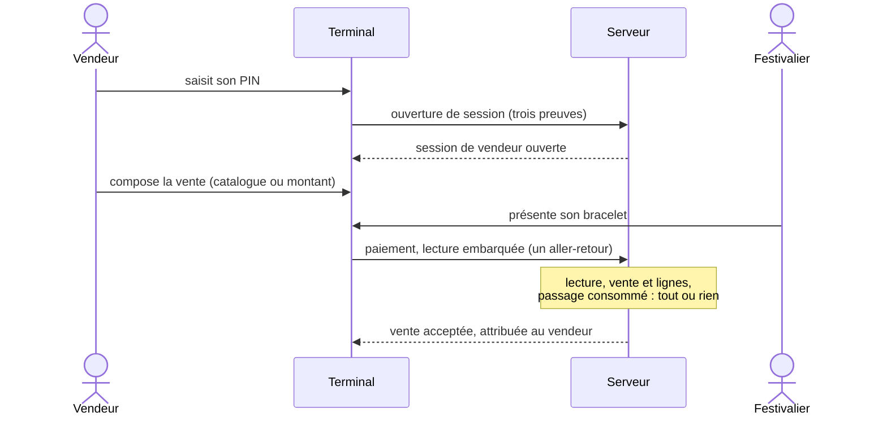

# Mission Specification: Encaissement en ligne

**Mission Branch**: `feat/terminaux-paiement-en-ligne`
**Created**: 2026-10-22
**Status**: Draft
**Input**: User description: "Encaissement en ligne (SPECIFICATION §8.1 à §8.3, §6.3, §7.6, §9.8, §14.2 S2, S18, S24). Vendeurs avec code PIN (argon2id), vente attribuée au vendeur. Paiement en un seul aller-retour (`POST /payments` : `register_tap`, `post_transaction`, `consume_tap` dans la même transaction SQL), parcours en deux temps avec `tap_id`, refus `WALLET_BLOCKED`, annulation dans la fenêtre du terminal, numérotation `<serial>:<seq>`. Catalogue par point de vente (catégories, articles TTC, taux par article, libellés FR/EN) et `sale_line` copiée dans la transaction de la vente. Paiement par QR commerçant et QR client (60 s, nonce haché, toujours en ligne). Identification au guichet (`kyc_verification`, révocation à deux). Hérité de la mission 5a : OP-N74 (ADR-120), refus d'un événement clos ou d'un point de vente supprimé à la création d'un code et à l'enrôlement."

**Sources normatives** : `docs/SPECIFICATION.md` (§3.2, §6.3, §7.6, §8.1, §8.2, §8.3, §9.8, §14.1 S24, §14.2 S2, S18), `docs/sync_protocol.md`, `docs/DECISIONS_ADR.md` (ADR-38, ADR-50, ADR-54, ADR-60, ADR-61, ADR-64, ADR-74, ADR-105, ADR-107, ADR-120), `docs/POINTS_OUVERTS.md` (OP-N74), `packages/ledger-sql/schema_grand_livre_cashless.sql` (`register_tap`, `consume_tap`, `post_transaction`, `payment_request`, `kyc_verification`, `wallet_kyc_level`, `check_wallet_limits`), `packages/contracts/openapi.yaml` (tags « Paiements », « Guichet », « App client » : `createTap`, `createPayment`, `getPayment`, `reversePayment`, `createPaymentRequest`, `getPaymentRequest`, `payPaymentRequest`, `cancelPaymentRequest`, `createCustomerQrToken`, `createKycVerification`, `revokeKycVerification`). En cas de contradiction, la règle de priorité de SPECIFICATION §0.3 s'applique et la contradiction est signalée.

**Dépend de** : missions `fondations-grand-livre-01M4AY8M` (moteur d'écritures, idempotence, erreurs normalisées), `identite-roles-double-validation-01M4DNDN` (personnes, rôles, demandes d'approbation, audit), `configuration-parties-evenements-01M4GCJ9` (événements, points de vente, commerçants, réglages `terminal_settings`, règles de frais), `bracelets-nfc-01M4TD3W` (lecture d'un bracelet, `POST /taps`, statuts des bracelets) et `identite-enrolement-terminaux-01M52R6H` (identité réelle du terminal, trois preuves, configuration servie, codes d'enrôlement).

## Contexte

Depuis la mission 5a, un terminal est enrôlé, reconnu à chaque requête par trois preuves et reçoit sa configuration. Il n'encaisse encore rien. Cette mission livre l'encaissement en ligne : les vendeurs qui se connectent au terminal par un code PIN, le catalogue d'articles de chaque point de vente, le paiement par bracelet en un seul aller-retour (ou en deux temps), l'annulation d'une vente, le paiement par QR (commerçant et client) et l'identification d'un festivalier au guichet, qui fixe ses plafonds de recharge.

Elle lève aussi OP-N74, hérité de la mission 5a : un code d'enrôlement et un enrôlement ne relisent pas encore l'état de l'événement ni du point de vente.

Le hors ligne (snapshot, lots, vérification du PIN sans réseau), l'application du festivalier, l'application du terminal et les écrans du back-office viennent dans d'autres missions.

Décisions de cadrage prises avec le porteur le 22/10/2026 (voir « Decisions ») : périmètre complet du PRD ; PIN vérifié par le serveur avec une session de vendeur liée au terminal ; annulation par le seul vendeur de la vente dans la fenêtre ; prix des lignes vérifiés contre la configuration servie au terminal ; enrôlement refusé dès la clôture pour les caisses ; PIN de 6 chiffres avec blocage dur.

**Métadonnées de la mission** : `meta.json` (créé le 16/10/2026, avant le découpage) décrit encore l'enrôlement et l'identité du terminal, livrés depuis par la mission 5a. Ces champs sont immuables ; c'est la présente spécification qui fixe le périmètre de la mission 5b.

## Domain Language

| Terme canonique | Sens | À éviter |
|---|---|---|
| Vendeur | Personne d'un commerçant qui encaisse sur un terminal (`vendor`, rôle `VENDOR`) ; n'a pas de compte du back-office | « caissier » (rôle `CASHIER` du guichet), « opérateur » |
| Code PIN | Code de 6 chiffres d'un vendeur, dont le serveur ne garde que l'empreinte | « mot de passe », « code secret » |
| Session de vendeur | Période pendant laquelle un vendeur est connecté à un terminal donné ; toute vente lui est attribuée | « connexion » seule, « login » |
| Vente | Écriture `PURCHASE` au profit du commerçant du point de vente du terminal | « transaction » seule, « achat » côté terminal |
| Ligne de vente | Détail d'une vente au catalogue : article, quantité, prix unitaire et taux de taxe copiés au moment de la vente (`sale_line`) | « article vendu », « item » |
| Catalogue | Catégories et articles d'un point de vente, à prix TTC fixe | « menu », « carte » |
| Passage | Lecture d'un bracelet enregistrée par la base (`register_tap`, `tap_id`) ; sert à une seule écriture | « tap » dans les textes destinés aux personnes, « scan » |
| Annulation | Contre-passation totale d'une vente (`REVERSAL`) | « remboursement » (qui désigne un retour d'argent au guichet), « avoir » |
| QR commerçant | QR affiché par le terminal, que le festivalier scanne dans l'app (`MERCHANT_QR`) | « QR de paiement » sans précision |
| QR client | QR affiché par l'app du festivalier, que le terminal scanne (`CUSTOMER_QR`) | « QR de paiement » sans précision |
| Identification | Contrôle d'une pièce d'identité au guichet qui rend `VERIFIED` les portefeuilles du client (`kyc_verification`) | « KYC » dans les textes destinés aux personnes, « vérification » seule |

## User Scenarios & Testing *(mandatory)*

### User Story 1 - Le commerçant gère ses vendeurs (Priority: P1)

Un `MERCHANT_ADMIN` crée les vendeurs de son commerce, leur donne un code PIN, les désactive et débloque un vendeur bloqué en lui donnant un nouveau PIN.

**Why this priority**: sans vendeur, aucune vente ne peut être attribuée, donc aucune vente n'est possible.

**Independent Test**: créer un vendeur par l'API, vérifier que la base ne garde que l'empreinte du PIN, le désactiver, puis le débloquer après 5 échecs.

**Acceptance Scenarios**:

1. **Given** un `MERCHANT_ADMIN` d'un commerçant, **When** il crée un vendeur avec un PIN de 6 chiffres, **Then** le vendeur existe, actif, rattaché à ce commerçant, et la base ne garde que l'empreinte du PIN.
2. **Given** un PIN qui n'a pas exactement 6 chiffres, **When** il est proposé, **Then** il est refusé.
3. **Given** une personne d'un autre commerçant ou sans le rôle, **When** elle crée, modifie ou lit un vendeur de ce commerçant, **Then** elle est refusée (`403`, ou `404` neutre pour l'objet d'un autre périmètre).
4. **Given** un vendeur bloqué après 5 échecs, **When** le `MERCHANT_ADMIN` lui donne un nouveau PIN, **Then** le vendeur est débloqué, son compteur d'échecs remis à zéro, et l'action est auditée.
5. **Given** un vendeur désactivé, **When** il tente d'ouvrir une session, **Then** il est refusé, et ses sessions ouvertes sont closes.

---

### User Story 2 - Le vendeur ouvre sa session sur le terminal (Priority: P1)

Le vendeur saisit son PIN sur un terminal de son commerce. Le terminal l'envoie une fois au serveur, qui le vérifie et ouvre une session de vendeur liée à ce terminal.

**Why this priority**: chaque vente est attribuée à un vendeur ; sans session, le terminal ne vend pas.

**Independent Test**: ouvrir une session par l'API avec le terminal de test, puis vérifier le blocage après 5 PIN faux et la fermeture de la session au bout de 12 h.

**Acceptance Scenarios**:

1. **Given** un terminal actif affecté à un point de vente d'un commerçant et un vendeur actif de ce commerçant, **When** le vendeur donne son bon PIN, **Then** une session de vendeur est ouverte pour ce terminal, valable 12 h au plus.
2. **Given** un PIN faux, **When** il est présenté, **Then** la réponse ne dit pas si le vendeur existe ni combien d'essais restent, et l'échec est compté et audité.
3. **Given** 5 échecs pour un même vendeur, sur un ou plusieurs terminaux, **When** un sixième essai arrive, même avec le bon PIN, **Then** il est refusé : le vendeur est bloqué jusqu'à ce que le commerçant le débloque.
4. **Given** un vendeur d'un autre commerçant que celui du point de vente du terminal, **When** il tente d'ouvrir une session, **Then** il est refusé comme un PIN faux.
5. **Given** une session ouverte, **When** le vendeur se déconnecte, le terminal est suspendu ou révoqué, ou le vendeur est désactivé, **Then** la session est close et toute vente suivante est refusée.

---

### User Story 3 - Le vendeur encaisse un paiement par bracelet en un seul aller-retour (Priority: P1)

Le vendeur compose une vente au catalogue (`CATALOG_POS`) ou saisit un montant (`KEYPAD_TPE`). Le festivalier présente son bracelet ; le terminal envoie la lecture et la vente dans une seule requête. Le serveur enregistre le passage, écrit la vente et consomme le passage ensemble : tout ou rien.

**Why this priority**: c'est le paiement de tous les jours sur le site, dans le délai d'un passage au comptoir.

**Independent Test**: payer par l'API avec le terminal de test et un bracelet de test, puis vérifier l'écriture, les lignes de vente, l'attribution au vendeur et le passage consommé.

**Acceptance Scenarios**:

1. **Given** une session de vendeur, un bracelet actif et un solde suffisant, **When** le terminal envoie le paiement avec la lecture embarquée, **Then** une vente `PURCHASE` est écrite au profit du commerçant du point de vente, attribuée au vendeur, son passage est consommé, et la réponse donne le nouveau solde.
2. **Given** un solde insuffisant, un bracelet bloqué ou un portefeuille bloqué, **When** le paiement est envoyé, **Then** il est refusé (`INSUFFICIENT_FUNDS` avec le solde disponible, `MEDIA_BLOCKED`, `WALLET_BLOCKED`), rien n'est écrit et le passage n'est pas enregistré : la même lecture peut servir à un nouvel essai.
3. **Given** une vente au catalogue, **When** elle est payée, **Then** chaque ligne (article, quantité, prix unitaire TTC, taux de taxe) est copiée dans la même transaction que la vente, et la somme des lignes est égale au montant.
4. **Given** le même paiement renvoyé avec la même clé d'idempotence, **When** il arrive une seconde fois, **Then** la même réponse est rendue et rien n'est écrit deux fois.
5. **Given** un paiement sans session de vendeur ouverte sur ce terminal, **When** il est envoyé, **Then** il est refusé.
6. **Given** un terminal iOS ou un mode qui n'accepte pas le NFC, **When** une lecture de bracelet est envoyée, **Then** elle est refusée.

---

### User Story 4 - Le vendeur encaisse en deux temps (Priority: P2)

Le terminal lit d'abord le bracelet (`POST /taps`), affiche le solde, puis paie avec le `tap_id` reçu.

**Why this priority**: utile quand le festivalier veut connaître son solde avant de payer ; le parcours en un aller-retour reste le parcours normal.

**Independent Test**: enregistrer une lecture, payer avec son `tap_id`, puis rejouer le même `tap_id` pour une autre vente.

**Acceptance Scenarios**:

1. **Given** une lecture enregistrée par `POST /taps`, **When** le paiement arrive avec son `tap_id` dans le délai `tap_replay_window_seconds`, **Then** la vente est écrite et le passage consommé dans la même transaction.
2. **Given** un `tap_id` déjà consommé par une autre vente, ou présenté après le délai, **When** il sert à un paiement, **Then** le paiement est refusé `409 TAP_UNUSABLE`.

---

### User Story 5 - Le vendeur annule une vente (Priority: P1)

Le vendeur qui a fait une vente l'annule depuis le terminal d'origine, dans la fenêtre d'annulation de l'événement (15 min par défaut). Au-delà, ou pour un autre vendeur, un `SUPERVISOR` annule.

**Why this priority**: une erreur de caisse se corrige par une annulation ; rien ne s'efface (G4).

**Independent Test**: annuler une vente par l'API dans la fenêtre, puis tenter une seconde annulation, une annulation par un autre vendeur et une annulation hors fenêtre.

**Acceptance Scenarios**:

1. **Given** une vente faite par un vendeur, **When** ce vendeur l'annule depuis le terminal d'origine dans la fenêtre, **Then** une contre-passation totale (`REVERSAL`) est écrite, liée à la vente, et le solde du festivalier est rendu.
2. **Given** une vente déjà annulée, **When** une seconde annulation arrive, **Then** elle est refusée `409 ALREADY_REVERSED`.
3. **Given** un autre vendeur, un autre terminal, ou une demande hors fenêtre, **When** il tente d'annuler depuis un terminal, **Then** il est refusé ; un `SUPERVISOR` de l'événement peut annuler.
4. **Given** une annulation, **When** elle est écrite, **Then** elle est attribuée à celui qui l'a faite (vendeur ou `SUPERVISOR`), sans recalcul des montants.

---

### User Story 6 - Le festivalier paie par QR (Priority: P2)

Avec un QR commerçant, le terminal affiche un QR (montant, jeton à usage unique, 60 s) que le festivalier scanne et paie dans l'app. Avec un QR client, l'app affiche un QR à usage unique (60 s) que le terminal scanne et présente au paiement.

**Why this priority**: seul moyen de payer sur un iPhone ; utile pour qui n'a pas son bracelet.

**Independent Test**: créer une demande de paiement par le terminal de test, la payer par l'API client, puis rejouer le jeton ; créer un QR client, le présenter au paiement, puis le rejouer.

**Acceptance Scenarios**:

1. **Given** une session de vendeur, **When** le terminal crée une demande de paiement, **Then** il reçoit un jeton à usage unique valable 60 s, et le serveur n'en garde que l'empreinte.
2. **Given** une demande valide, **When** le festivalier connecté la paie, **Then** une vente `PURCHASE` est écrite, attribuée au vendeur de la session qui l'a créée, et la demande devient `CONFIRMED`.
3. **Given** un QR client valide, **When** le terminal le présente au paiement avec un montant, **Then** la vente est écrite et le jeton ne sert plus.
4. **Given** un jeton expiré, déjà utilisé, annulé ou inconnu, **When** il est présenté, **Then** il est refusé, sans dire lequel de ces cas s'applique.
5. **Given** un QR commerçant ou client, **When** il est payé, **Then** le paiement est en ligne des deux côtés ; aucun jeton n'est préchargé.

---

### User Story 7 - L'agent du guichet identifie un festivalier (Priority: P2)

Un `CASHIER` ou un `ORGANIZER_ADMIN` contrôle la pièce d'identité d'un festivalier qui a un compte au numéro vérifié, et enregistre l'identification. Deux administrateurs peuvent la révoquer.

**Why this priority**: l'identification relève les plafonds de recharge et de solde (§6.3) ; sans elle, les plafonds d'un portefeuille non identifié s'appliquent.

**Independent Test**: identifier un client par l'API, vérifier que ses portefeuilles deviennent `VERIFIED`, puis révoquer à deux et vérifier le retour à `NONE`.

**Acceptance Scenarios**:

1. **Given** un festivalier au numéro vérifié qui présente son portefeuille et une pièce, **When** l'agent saisit le type de pièce, le pays d'émission, les 4 derniers caractères du numéro et la date d'expiration, **Then** l'identification est enregistrée (méthode `DESK`) et tous les portefeuilles du client sont `VERIFIED` tant que la pièce n'est pas expirée.
2. **Given** un agent titulaire du portefeuille présenté, **When** il tente de l'identifier, **Then** il est refusé.
3. **Given** un numéro de pièce complet ou une photo, **When** ils sont envoyés sans que le profil de législation l'exige, **Then** ils sont refusés ou ignorés ; seuls les 4 derniers caractères sont gardés.
4. **Given** une demande de révocation par un administrateur, **When** un second administrateur, distinct, l'approuve, **Then** l'identification passe à `REVOKED` avec l'auteur et le motif, et les plafonds non identifiés s'appliquent aux opérations suivantes.

---

### User Story 8 - Un terminal n'est plus enrôlé sur un événement clos (Priority: P1)

Hérité de la mission 5a (OP-N74, ADR-120) : la création d'un code d'enrôlement et l'enrôlement relisent l'état de l'événement et du point de vente.

**Why this priority**: maintenant que le terminal encaisse, un enrôlement sur un événement fini ou un point de vente supprimé ouvrirait une caisse qui ne devrait plus exister.

**Independent Test**: tenter de créer un code et d'enrôler un terminal pour chaque état de l'événement et chaque mode, et sur un point de vente supprimé.

**Acceptance Scenarios**:

1. **Given** un événement en clôture ou au-delà (`CLOSING`, `RECONCILING`, `SETTLING`, `REFUND_WINDOW`), **When** un code est demandé ou un terminal s'enrôle en `CATALOG_POS` ou `KEYPAD_TPE`, **Then** c'est refusé, sans rien écrire.
2. **Given** le même événement, **When** le mode est `TOPUP_DESK`, **Then** c'est accepté (guichet de remboursement).
3. **Given** un événement `CLOSED` ou un point de vente supprimé depuis l'émission du code, **When** un code est demandé ou un terminal s'enrôle, quel que soit le mode, **Then** c'est refusé, sans rien écrire.

### Edge Cases

- Deux paiements envoyés en même temps avec la même lecture : une seule vente est écrite.
- Deux annulations simultanées de la même vente : une seule réussit.
- Le même jeton QR payé deux fois en même temps : un seul paiement réussit.
- Changement de prix d'un article pendant qu'un terminal a encore l'ancienne configuration : la vente au prix de la configuration servie à ce terminal est acceptée ; un prix qui ne correspond ni à elle ni au prix actuel est refusé, et le terminal se resynchronise.
- Article désactivé, d'un autre point de vente ou inconnu dans les lignes : vente refusée.
- Somme des lignes différente du montant : vente refusée.
- Session de vendeur expirée au milieu d'une vente : la vente est refusée ; le vendeur rouvre sa session.
- PIN essayé sur plusieurs terminaux pour contourner le blocage : les échecs sont comptés par vendeur, tous terminaux confondus.
- Terminal suspendu avec une session de vendeur ouverte : aucune vente ni annulation n'est autorisée.
- Grand livre en clôture (`CLOSING`) : la vente en ligne est refusée `EVENT_CLOSING`.
- Autorité de débit à la passerelle ou en cours de bascule : `DEBIT_AUTHORITY_EDGE`, ou `409 DEBIT_AUTHORITY_MOVING`, qui n'est pas un refus définitif (même clé ensuite).
- Téléphone personnel : en ligne seulement, aucune recharge ni remboursement ; une demande de ces opérations est refusée.
- Plafond de solde d'un portefeuille non identifié : une annulation qui rend un solde n'est jamais refusée pour ce motif.
- Identification d'un client dont la pièce expire : ses portefeuilles redeviennent `NONE` à la date d'expiration, sans tâche planifiée.

## Requirements *(mandatory)*

### Functional Requirements

| ID | Title | User Story | Priority | Status |
|----|-------|------------|----------|--------|
| FR-001 | Vendeurs d'un commerçant | En tant que `MERCHANT_ADMIN`, je veux créer, lister, consulter, désactiver et réactiver les vendeurs de mon commerce, afin que chaque vente soit attribuée à une personne précise. | High | Open |
| FR-002 | Code PIN du vendeur | En tant que `MERCHANT_ADMIN`, je veux donner à un vendeur un code PIN d'exactement 6 chiffres, dont le serveur ne garde que l'empreinte (argon2id), et le changer, afin que seul le vendeur puisse encaisser en son nom. | High | Open |
| FR-003 | Session de vendeur | En tant que vendeur, je veux ouvrir une session sur un terminal de mon commerce avec mon PIN, vérifié par le serveur, afin que mes ventes me soient attribuées ; la session est liée à ce terminal et dure 12 h au plus. | High | Open |
| FR-004 | Blocage après échecs | En tant que commerçant, je veux qu'un vendeur soit bloqué après 5 PIN faux, comptés par vendeur tous terminaux confondus, jusqu'à ce que je le débloque en lui donnant un nouveau PIN, afin qu'un PIN ne se trouve pas par essais. | High | Open |
| FR-005 | Fin d'une session | En tant que commerçant, je veux qu'une session de vendeur se ferme à la déconnexion, au bout de 12 h, à la suspension ou à la révocation du terminal et à la désactivation du vendeur, afin qu'aucune vente ne soit faite au nom d'un vendeur absent. | High | Open |
| FR-006 | Attribution par le serveur | En tant que commerçant, je veux que chaque vente et chaque annulation soient attribuées par le serveur d'après la session ouverte sur le terminal, jamais d'après un champ envoyé par le terminal, afin que les relevés par vendeur soient fiables. | High | Open |
| FR-007 | Catalogue d'un point de vente | En tant qu'organisateur, je veux gérer le catalogue de chaque point de vente (catégories ordonnées, articles à prix TTC fixe, taux de taxe par article en points de base, libellés en français et en anglais, actif ou non), et autoriser un commerçant à gérer le sien, afin que la caisse vende des articles. | High | Open |
| FR-008 | Catalogue servi au terminal | En tant que terminal en mode `CATALOG_POS`, je veux recevoir le catalogue de mon point de vente dans ma configuration ; une modification produit une nouvelle configuration servie, prise au battement de cœur suivant. | High | Open |
| FR-009 | Paiement par bracelet en un aller-retour | En tant que vendeur, je veux encaisser un paiement par bracelet en une seule requête qui porte la lecture : enregistrement du passage, écriture de la vente et consommation du passage dans la même transaction, tout ou rien, afin de payer dans le délai d'un passage au comptoir. | High | Open |
| FR-010 | Paiement en deux temps | En tant que vendeur, je veux pouvoir lire d'abord le bracelet puis payer avec le `tap_id` reçu, dans le délai `tap_replay_window_seconds` ; un passage déjà consommé ou trop ancien est refusé `409 TAP_UNUSABLE`. | Medium | Open |
| FR-011 | Lignes de vente | En tant que commerçant, je veux que chaque vente au catalogue enregistre ses lignes (article, quantité, prix unitaire TTC, taux de taxe, total) dans la même transaction que la vente, prix et taux copiés, afin qu'un changement de catalogue ne modifie pas l'historique et que les relevés détaillent les ventes par article et par taux. | High | Open |
| FR-012 | Prix vérifiés | En tant qu'organisateur, je veux que le serveur refuse une ligne dont l'article est inconnu, inactif ou d'un autre point de vente, dont le prix n'est ni celui de la configuration servie au terminal ni le prix actuel, ou dont la somme ne fait pas le montant, afin qu'aucune vente ne se fasse à un prix inventé. | High | Open |
| FR-013 | Montant saisi | En tant que vendeur en mode `KEYPAD_TPE`, je veux encaisser un montant saisi, sans ligne de catalogue. | High | Open |
| FR-014 | Refus d'un paiement | En tant que festivalier, je veux qu'un paiement refusé (solde insuffisant avec le solde disponible, bracelet bloqué `MEDIA_BLOCKED`, portefeuille bloqué ou clos `WALLET_BLOCKED`, lecture invalide `MEDIA_*`, événement en clôture `EVENT_CLOSING`) n'écrive rien et n'enregistre pas le passage. | High | Open |
| FR-015 | Moyens selon le terminal | En tant que plateforme, je veux qu'un terminal iOS ou dont le mode n'accepte pas le NFC ne puisse pas payer par bracelet, et qu'un téléphone personnel n'encaisse qu'en ligne, sans recharge ni remboursement. | High | Open |
| FR-016 | Annulation | En tant que vendeur, je veux annuler une de mes ventes depuis le terminal d'origine dans la fenêtre `reversal_window_minutes` de l'événement, par une contre-passation totale liée à la vente ; une vente ne s'annule qu'une fois (`409 ALREADY_REVERSED`). | High | Open |
| FR-017 | Annulation par un responsable | En tant que `SUPERVISOR` de l'événement, je veux annuler une vente hors fenêtre ou faite par un autre vendeur ; un vendeur autre que celui de la vente, ou un autre terminal, est refusé. | High | Open |
| FR-018 | QR commerçant | En tant que vendeur, je veux créer une demande de paiement affichée en QR (montant, jeton à usage unique, 60 s), que le festivalier paie dans son app ; je peux l'annuler tant qu'elle n'est pas payée. | Medium | Open |
| FR-019 | QR client | En tant que vendeur, je veux présenter au paiement le QR à usage unique (60 s) affiché par l'app du festivalier, avec le montant de la vente. | Medium | Open |
| FR-020 | Jetons QR | En tant que plateforme, je veux que le serveur ne garde que l'empreinte d'un jeton QR, qu'un jeton serve une seule fois, et qu'un jeton expiré, utilisé, annulé ou inconnu soit refusé sans dire lequel ; les deux sens sont toujours permis, en ligne seulement. | High | Open |
| FR-021 | Identification au guichet | En tant que `CASHIER` ou `ORGANIZER_ADMIN`, je veux identifier un festivalier au numéro vérifié (type de pièce, pays d'émission, 4 derniers caractères, date d'expiration ; méthode `DESK`), sauf pour un portefeuille dont je suis titulaire, afin de relever ses plafonds. | Medium | Open |
| FR-022 | Révocation d'une identification à deux | En tant qu'`OPERATOR_ADMIN` ou `ORGANIZER_ADMIN`, je veux demander la révocation d'une identification avec un motif ; elle n'est exécutée qu'à l'approbation d'une seconde personne distincte (action `KYC_REVOCATION`). | Medium | Open |
| FR-023 | Niveau d'identification appliqué | En tant que plateforme, je veux que le niveau d'identification soit calculé à la date de chaque opération et que les plafonds du profil de législation s'appliquent en conséquence ; une annulation qui rend un solde n'est jamais refusée pour le plafond de solde. | Medium | Open |
| FR-024 | Enrôlement et état de l'événement (OP-N74) | En tant que plateforme, je veux que la création d'un code d'enrôlement et l'enrôlement soient refusés pour un événement `CLOSED` ou un point de vente supprimé, et, dès `CLOSING`, pour les modes `CATALOG_POS` et `KEYPAD_TPE` (le mode `TOPUP_DESK` reste permis jusqu'à `CLOSED`), sans rien écrire. | High | Open |
| FR-025 | Consultation d'un paiement | En tant que terminal ou personne habilitée, je veux consulter un paiement de mon périmètre (montant, moyen, vendeur, lignes, annulation éventuelle). | Medium | Open |
| FR-026 | Audit | En tant qu'auditeur, je veux une ligne d'audit pour chaque création, modification, désactivation et déblocage d'un vendeur, chaque ouverture et fermeture de session, chaque échec et blocage de PIN, chaque modification du catalogue, chaque annulation, chaque identification et chaque révocation. | High | Open |
| FR-027 | Contrat et types | En tant qu'équipe, je veux que les routes des vendeurs, des sessions de vendeur et du catalogue soient ajoutées au contrat d'API avec les conventions existantes, que les routes de terminal exigent les trois preuves, et que les types TypeScript et Dart soient régénérés. | High | Open |

### Non-Functional Requirements

| ID | Title | Requirement | Category | Priority | Status |
|----|-------|-------------|----------|----------|--------|
| NFR-001 | Latence du paiement | Paiement par bracelet en un aller-retour, serveur seul : p95 ≤ 200 ms et p99 ≤ 500 ms sur 200 paiements en série (ADR-60). | Performance | High | Open |
| NFR-002 | Aucun PIN en clair | 0 PIN en clair ni empreinte de PIN dans les réponses, les journaux, l'audit, les erreurs et la configuration servie ; l'empreinte ne quitte jamais le serveur. Vérifié par une recherche des PIN de test après un parcours complet. | Security | High | Open |
| NFR-003 | Blocage du PIN | 0 session ouverte après le 5e échec d'un vendeur, y compris avec le bon PIN et sur d'autres terminaux ; 20 essais simultanés de PIN faux sur un vendeur : au plus 5 comptés avant le blocage, aucun ne passe. | Security | High | Open |
| NFR-004 | Pas d'énumération des vendeurs | PIN faux, vendeur inconnu, vendeur d'un autre commerçant : même statut et même corps de réponse. | Security | High | Open |
| NFR-005 | Un passage, une vente | 20 paiements simultanés avec la même lecture ou le même `tap_id` : exactement 1 vente ; 20 paiements simultanés avec le même jeton QR : exactement 1 vente ; 20 annulations simultanées d'une vente : exactement 1 annulation. | Reliability | High | Open |
| NFR-006 | Tout ou rien | 0 vente sans ses lignes, 0 ligne sans vente, 0 passage consommé par un paiement refusé : vérifié sur chaque refus. | Reliability | High | Open |
| NFR-007 | Isolation | 0 vendeur, session, article, vente ou identification d'un autre prestataire ou commerçant lisible ou modifiable, sur chaque route et chaque nouvelle table. | Security | High | Open |
| NFR-008 | Aucun jeton QR en clair | 0 jeton QR en clair dans la base, les journaux et l'audit ; seules les empreintes sont gardées. | Security | High | Open |
| NFR-009 | Pas de faux en production | Les garde-fous de démarrage des missions 4 et 5a restent actifs ; aucun nouveau faux n'est atteignable en production, un test par faux ajouté. | Security | High | Open |
| NFR-010 | Tests existants verts | Suites de la base, tests des missions 1 à 5a et rejeu du scénario de référence verts en CI à chaque commit. | Reliability | High | Open |

### Constraints

| ID | Title | Constraint | Category | Priority | Status |
|----|-------|------------|----------|----------|--------|
| C-001 | Les fonctions de la base font les règles | Les règles de paiement (lecture, écriture, consommation du passage), d'annulation, d'identification et de refus de l'enrôlement sont tenues par la base ; l'API les appelle sans les réécrire. | Technical | High | Open |
| C-002 | Fichiers générés du kit intouchables | Les fichiers `.sql` générés de `packages/ledger-sql/` ne sont jamais modifiés à la main ; tout ajout (S2, S18, OP-N74) passe par une migration, et les attentes de la suite de référence par ses générateurs. | Technical | High | Open |
| C-003 | Trois preuves sur les routes de terminal | Toute route appelée par un terminal exige le jeton lié, le mTLS et la signature de la requête (mission 5a, ADR-107). | Technical | High | Open |
| C-004 | Contrat d'abord | Toute route est décrite au contrat d'API avant d'être servie ; les types sont générés, jamais écrits à la main. | Technical | High | Open |
| C-005 | Pas de hors ligne | Snapshot, lots hors ligne, ventes hors ligne et vérification du PIN sans réseau relèvent de la mission 7 ; un terminal de cette mission encaisse en ligne seulement. | Business | High | Open |
| C-006 | Pas d'application ni d'écran | L'application du festivalier (mission 10), le back-office web (mission 11) et l'application du terminal (mission 12) ne sont pas dans cette mission ; le terminal de test et des appels d'API servent aux tests. | Business | High | Open |
| C-007 | Pas d'intention de paiement | Les intentions de paiement des caisses tierces et le mode `PAIRED_TPE` sont V2 (ADR-43) : refusés. | Business | High | Open |
| C-008 | Pas de vérification en ligne de l'identité | Seule la méthode `DESK` est servie ; la méthode `ONLINE` reste prévue par l'interface sans être implémentée (§6.3). | Business | Medium | Open |
| C-009 | Écart de sécurité soumis au porteur | Tout écart au plan ou à la spécification qui affaiblit la sécurité est soumis au porteur avant d'être codé, avec le risque et les options ; un écart qui renforce la sécurité est fait puis consigné. | Business | High | Open |
| C-010 | Dette de sécurité nommée | Chaque écart de sécurité accepté a une entrée dans `docs/POINTS_OUVERTS.md` et une décision dans `docs/DECISIONS_ADR.md` (risque, raison, mission qui le lève, condition de levée), un test qui échoue si la limite s'élargit, et un report dans `PROMPTS-A-ENVOYER.md` et `PRD.md` pour la mission qui en hérite. | Business | High | Open |
| C-011 | Révocation d'une identification à deux | Le contrat (`revokeKycVerification`) exige deux personnes ; SPECIFICATION §6.3 dit « un administrateur PEUT révoquer ». Contradiction signalée ; le contrat prime (§0.3) et il est le plus sûr. | Technical | High | Open |

### Key Entities

- **Vendeur** (`vendor`, S2) : personne d'un commerçant ; nom affiché, empreinte du PIN, statut (actif, désactivé), compteur d'échecs, blocage.
- **Session de vendeur** : vendeur, terminal, ouverture, fin prévue (12 h au plus), fermeture et motif.
- **Catégorie de catalogue** (`catalog_category`, S18) : point de vente, libellés FR et EN, ordre.
- **Article** (`catalog_item`, S18) : catégorie, libellés FR et EN, prix TTC, taux de taxe en points de base, actif.
- **Ligne de vente** (`sale_line`, S18) : vente, article, quantité, prix unitaire TTC, taux de taxe, total, copiés au moment de la vente.
- **Vente** : écriture `PURCHASE` du grand livre, avec son vendeur, son terminal, son passage ou son jeton QR.
- **Annulation** : écriture `REVERSAL` liée à la vente, avec son auteur.
- **Demande de paiement** (`payment_request`, schéma de référence) : QR commerçant ou client, montant, empreinte du jeton, expiration, statut.
- **Identification** (`kyc_verification`, schéma de référence) : client, portefeuille présenté, méthode, agent, données de la pièce (4 derniers caractères), statut, révocation avec auteur et motif.
- **Ligne d'audit** : action sur un vendeur, une session, le catalogue, une vente, une identification.

## Success Criteria *(mandatory)*

### Measurable Outcomes

- **SC-001** : un parcours complet (créer un vendeur et le catalogue, ouvrir une session, payer par bracelet en un aller-retour et en deux temps, payer par QR commerçant et par QR client, annuler, identifier un festivalier puis révoquer l'identification à deux) se déroule par l'API sans intervention directe en base.
- **SC-002** : 100 % des ventes du parcours sont attribuées au bon vendeur, et 100 % des ventes au catalogue ont des lignes dont la somme fait le montant.
- **SC-003** : aucun PIN, empreinte de PIN ni jeton QR en clair n'est retrouvé dans la base, les journaux ni les réponses après le parcours.
- **SC-004** : un vendeur bloqué après 5 échecs ne peut plus ouvrir de session sur aucun terminal tant que le commerçant ne l'a pas débloqué.
- **SC-005** : aucune lecture, aucun jeton QR ni aucune vente ne sert deux fois, même sous envois simultanés.
- **SC-006** : un paiement par bracelet est accepté en 200 ms au plus pour 95 % des paiements, côté serveur.
- **SC-007** : aucune fuite entre deux prestataires ou commerçants sur l'ensemble des routes de la mission.
- **SC-008** : OP-N74 est clos dans les points ouverts avec son test ; à la fin de la mission, chaque écart de sécurité accepté est consigné avec la mission qui le lève.

## Assumptions

- Un vendeur appartient à un commerçant et peut ouvrir une session sur tout terminal affecté à un point de vente de ce commerçant ; un terminal porte une seule session de vendeur à la fois.
- Les routes des vendeurs, des sessions de vendeur et du catalogue sont ajoutées au contrat avec les conventions existantes ; leur forme exacte est arrêtée au plan.
- Le prix accepté pour une ligne est celui du catalogue dans la configuration servie au terminal (`config_id`) ou le prix actuel ; le moyen de retrouver le catalogue d'une configuration servie est arrêté au plan.
- La vérification du PIN (argon2id) est assez coûteuse pour ralentir des essais en masse et assez rapide pour une ouverture de session au comptoir ; ses paramètres sont arrêtés au plan.
- Le paiement par l'app d'un QR commerçant est appelé avec l'authentification du festivalier (compte au numéro vérifié) ; la confirmation par PIN ou biométrie dans l'app relève de la mission 10.
- Les frais et commissions d'une vente sont calculés par les règles `REALTIME` existantes ; aucune nouvelle règle de frais.
- Les codes `CL` de la base sont traduits en erreurs normalisées par le mécanisme de la mission 1, avec les codes du contrat.

## Decisions

| # | Question | Décision du porteur |
|---|---|---|
| 1 | Garder la mission 5 entière ou la scinder | Scinder en 5a puis 5b — 16/10/2026 (`DM-01M52QCYW4EK4V5TGGDFYGRYMY`) |
| 2 | Périmètre de la 5b | Tout le périmètre du PRD — 22/10/2026 (`DM-01M5HJVXVG29N2D3T5FJMJQ8DT`) |
| 3 | Vérification du PIN vendeur | Par le serveur, session de vendeur liée au terminal, attribution par le serveur ; aucune empreinte hors du serveur ; le hors ligne est tranché par la mission 7 — 22/10/2026 (`DM-01M5HJXZ4QPS4NY8SABQKY95Q2`) |
| 4 | Qui annule dans la fenêtre | Seul le vendeur de la vente, depuis le terminal d'origine ; sinon `SUPERVISOR` — 22/10/2026 (`DM-01M5HK2NSDD1SSE3KDM4SCAW72`) |
| 5 | Prix des lignes de vente | Prix de la configuration servie au terminal ou prix actuel ; sinon refus et resynchronisation — 22/10/2026 (`DM-01M5HK8RJSX2KVK7Y6Y0C7XSRD`) |
| 6 | États de l'événement qui bloquent l'enrôlement (OP-N74) | Dès `CLOSING` pour `CATALOG_POS` et `KEYPAD_TPE` ; `TOPUP_DESK` jusqu'à `CLOSED` ; `CLOSED` et point de vente supprimé refusent tout — 22/10/2026 (`DM-01M5HKDXSTFR5JS88GZ4B2EA5J`) |
| 7 | Règles du PIN | 6 chiffres ; 5 échecs par vendeur, tous terminaux, bloquent jusqu'au déblocage par le commerçant ; session de 12 h au plus — 22/10/2026 (`DM-01M5HKT8GW5ZCAESAJC6WV5S6H`) |
| 8 | Résumé d'intention | Confirmé — 22/10/2026 |
