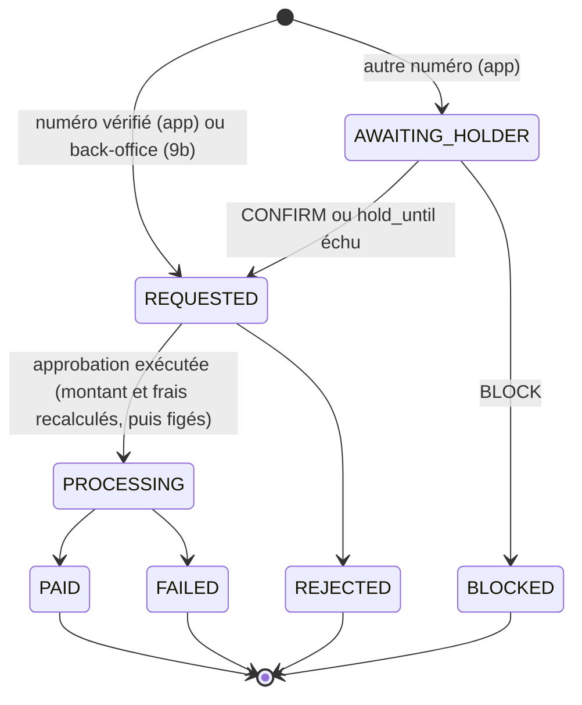

# Data Model: Versements, rapprochements et clôture (mission 9b)

Migrations `0083` et suivantes ; le schéma de référence et les `.sql` générés ne sont pas modifiés. Chaque table nouvelle
porte `operator_id`, RLS `ENABLE` + `FORCE`, et une garde de portée à l'insertion. `cashless_app` n'a aucun `DELETE`.
Les droits sont dans une nouvelle section de `post-roles.sql`.

## Tables nouvelles

### `closing_step` (R-01)

| Colonne | Type | Règle |
|---|---|---|
| `operator_id`, `event_id` | uuid | événement du prestataire |
| `step` | text | `PITCH_FEES`, `OPERATOR_FEE`, `PLATFORM_FEE`, `OPERATOR_FEE_REGULARIZATION`, `BREAKAGE`, `DEPOSIT_FORFEIT`, `PROMO_EXPIRY` |
| `status` | text | `DONE` ou `NOT_APPLICABLE` (aucune ligne = à faire) |
| `done_by`, `done_at` | uuid, timestamptz | auteur et date |
| `transaction_ids` | uuid[] | écritures produites (vide si sans objet) |
| `summary` | jsonb | montants par bénéficiaire (pour l'audit et les relevés) |

- PK (`event_id`, `step`). Ajout seul : aucun `UPDATE` ni `DELETE`.
- Écrite par la fonction `record_closing_step` (DEFINER), dans la transaction des écritures.

### `statement_import` (R-08)

`id`, `operator_id`, `ledger_id`, `account_id` (compte `ASSET` du grand livre), `source`, `file_sha256` (unique par
compte), `statement_date`, `closing_balance`, `currency`, `imported_by`, `imported_at`, `lines_created`,
`lines_existing`, `lines_matched`. Ajout seul.

### `account_mapping` (R-14, S22)

`operator_id`, `entity_party_id`, `version` (int croissant), `valid_from`, `purpose`, `transaction_type` (nul = tous),
`debit_account`, `credit_account`, `created_by`. PK (`operator_id`, `entity_party_id`, `version`, `purpose`,
`transaction_type`). Une nouvelle version remplace la précédente à partir de `valid_from`. Ajout seul.

## Tables existantes modifiées (colonnes ajoutées seulement)

### `payout` (R-06, R-07)

- **Colonnes ajoutées** : `approval_request_id` (lot), `msisdn`, `iban`, `failure_reason`, `confirmed_by`,
  `confirmed_at`. CHECK : `msisdn` ou `iban` selon `method` ; `failure_reason` si et seulement si `FAILED`.
- **Droits** : `cashless_app` passe à `SELECT` seulement. Insertion par `create_payout_batch`, résultat par
  `settle_payout` (deux fonctions DEFINER).
- **Déclencheur de transition** : `INITIATED` → `CONFIRMED` ou `FAILED`, une fois ; aucune autre colonne modifiable.

### `external_statement_line` (R-08)

- **Colonnes ajoutées** : `statement_import_id`, `currency`, `matched_anomaly_id`, `matched_by`, `matched_at`.
- **Unicité** : un nouvel index unique (`account_id`, `source`, `external_ref`) remplace l'usage de l'ancien. L'ancienne
  contrainte n'est pas retirée ; elle couvre déjà un cas plus strict.

  [Note du plan : l'ancienne `UNIQUE (source, external_ref)` empêche deux événements d'un même prestataire de partager
  une source et une référence. Elle reste en place, ce qui est conservateur : une référence externe de PSP est unique
  par fournisseur. À revoir seulement si un relevé réel la heurte.]
- **Garde de portée** à l'insertion : grand livre, compte et prestataire cohérents, compte de famille `ASSET`.
- **Droits** : `cashless_app` passe à `SELECT` seulement. Écritures par `import_statement_lines` et
  `match_statement_line` (DEFINER). Un rapprochement posé ne se défait pas en 9b.

### `refund_request` (OP-N130, R-10)

- **Déclencheur `refund_request_transition_guard`** : `BEFORE UPDATE`. Il refuse :
  - toute transition hors graphe ;
  - toute modification d'`estimated_amount` et `fee` hors du passage `REQUESTED` → `PROCESSING`.

  Il laisse passer `promote_due_refund_requests`, qui fait `AWAITING_HOLDER` → `REQUESTED`.

`CANCELLED` : aucune transition en 9b (aucune route ne la produit) ; le déclencheur la refuse.

## Fonctions SQL nouvelles ou redéfinies

| Fonction | Sécurité | Appelée par | Rôle |
|---|---|---|---|
| `set_event_status`, `event_transition_conditions` (redéfinies) | DEFINER, `assert_tenant` | route de statut | conditions `NO_OPEN_CASH_SESSION`, `REFUND_DEADLINE_REACHED`, `CLOSING_STEPS_DONE`, `PSP_RECONCILED` calculée ; test pgTAP d'égalité des deux copies |
| `record_closing_step(event, step, status, tx[], summary)` | DEFINER, `assert_tenant` | service des étapes | ajout seul dans `closing_step` |
| `create_payout_batch(ledger, approval_request, lines jsonb, actor, approver)` | DEFINER, `assert_tenant` | action `PAYOUT` | verrou des comptes, borne du droit net (`CL055`), `PAYOUT_INITIATED`, lignes `payout` |
| `settle_payout(payout, outcome, ref, reason, actor)` | DEFINER, `assert_tenant` | `confirmPayout` | `PAYOUT_CONFIRMED` ou `PAYOUT_FAILED`, mise à jour unique |
| `import_statement_lines(import jsonb, lines jsonb)` | DEFINER, `assert_tenant` | `importAccountStatement` | import, dédoublonnage, rapprochement automatique |
| `match_statement_line(line, tx, anomaly, actor)` | DEFINER, `assert_tenant` | `matchStatementLine` | rapprochement manuel contrôlé |
| `account_reconciliation(ledger)` | STABLE DEFINER, `assert_tenant` | condition `PSP_RECONCILED`, `getLedgerReconciliation` | état par compte |
| `refund_deposit_for_session(media, session, actor, approver)` (nouvelle signature) | DEFINER | `release.service.ts` | OP-N128 |
| `ops_*` (R-11 à R-13) | DEFINER, sans `assert_tenant`, EXECUTE à `cashless_maint` seul | travailleurs | scellement, copie, vérification, contrôles, alertes, transactions longues |

## Invariants (testés en pgTAP)

1. Une étape de clôture est faite au plus une fois par événement (PK).
2. Pour chaque bénéficiaire, à tout instant : versements `INITIATED` non réglés ≤ droit net au moment de l'initiation.
3. Une ligne `payout` change de statut au plus une fois, d'`INITIATED` vers `CONFIRMED` ou `FAILED`.
4. Une ligne de relevé est rapprochée au plus une fois, à une transaction ou une anomalie du même prestataire et du même
   grand livre, qui touche le même compte.
5. Une demande de remboursement ne suit que le graphe ci-dessus ; montant et frais sont figés après `PROCESSING`.
6. `cashless_app` n'a ni `DELETE` ni `UPDATE` direct sur `payout`, `external_statement_line`, `closing_step`,
   `statement_import` et `account_mapping`. La liste exacte des droits par rôle est testée et échoue si elle s'élargit.
7. `cashless_maint` n'a aucune lecture de table ; ses seules fonctions sont listées et testées.
