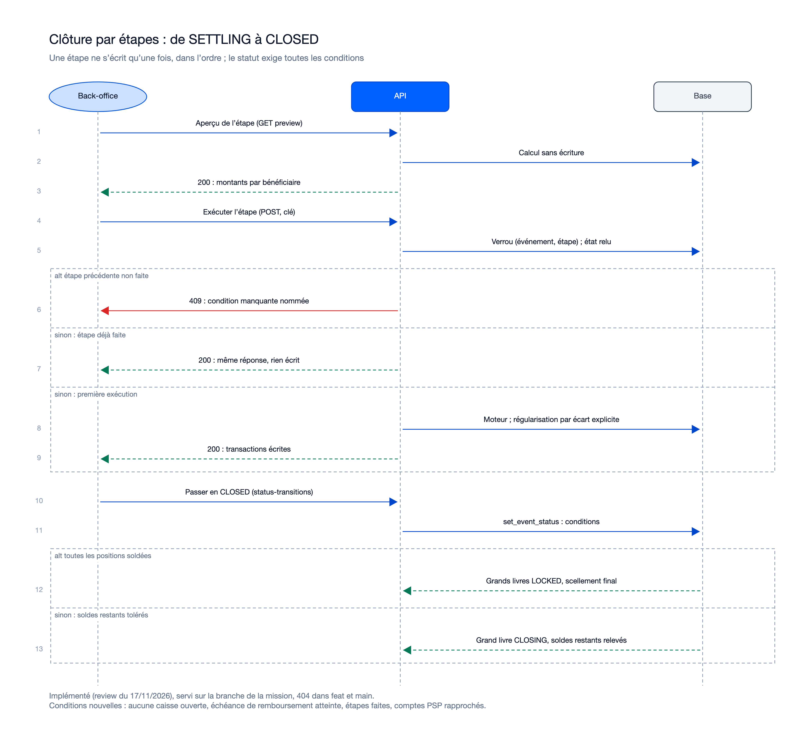
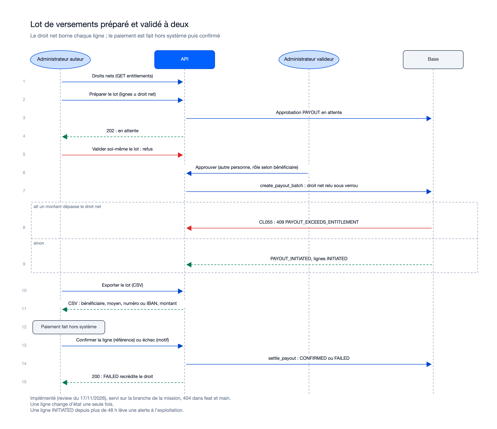
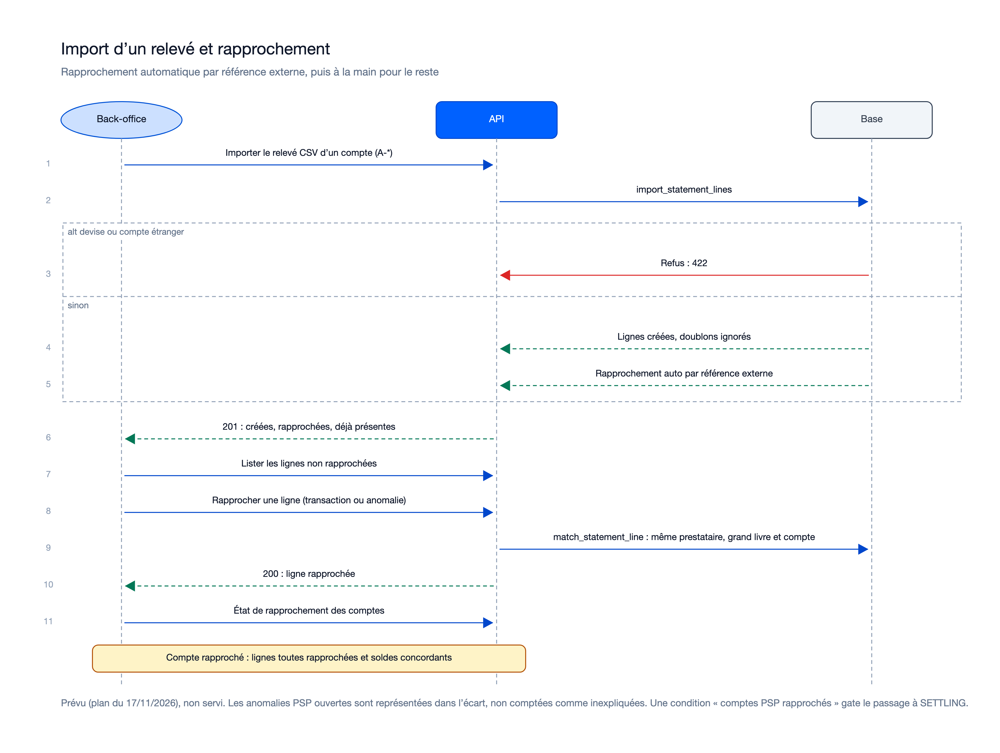
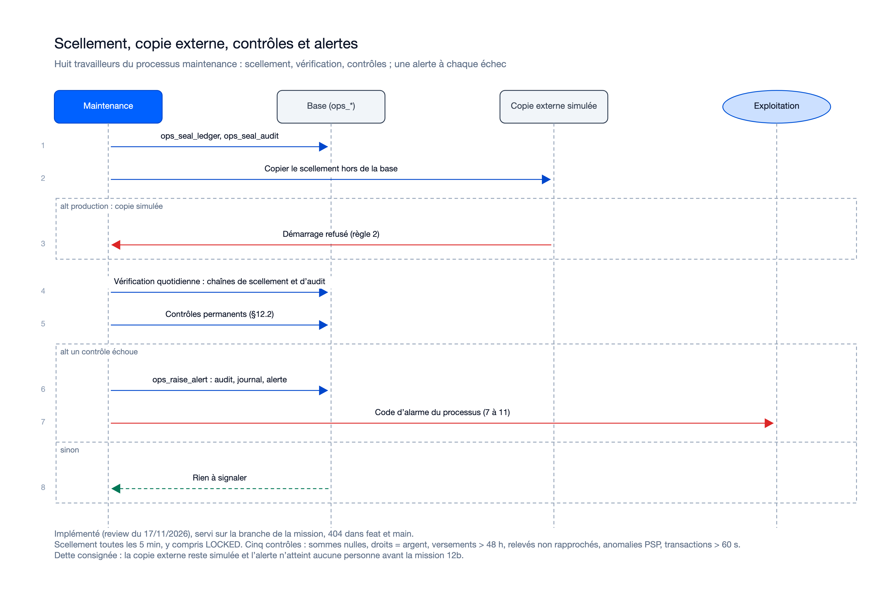

# Séquences : mission versements-rapprochements-cloture-01M7JT4G

> État : **review terminée le 17/11/2026 (14 lots sur 14 approuvés), non acceptée, non consolidée**. Quatre diagrammes `/illustre` régénérés à la review, rendus relus ; sources dans [`diagrams/`](diagrams/) (`generate.py`). Flux servis sur la branche de la mission.

## Flux internes propres à cette mission

### Clôture par étapes

Sources : [`sequence-cloture.excalidraw`](diagrams/sequence-cloture.excalidraw), [`sequence-cloture.svg`](diagrams/sequence-cloture.svg).
L'aperçu calcule sans écrire. L'exécution prend un verrou par (événement, étape), relit l'état, refuse si une étape précédente manque (`409`), répond à l'identique si l'étape est déjà faite, sinon écrit par le moteur et enregistre `closing_step`. Le passage en `CLOSED` exige les conditions (caisse, échéance, étapes, comptes PSP) puis verrouille les grands livres soldés ; sinon `CLOSING` et relevé des soldes restants.

### Lot de versements préparé et validé à deux

Sources : [`sequence-lot-versements.excalidraw`](diagrams/sequence-lot-versements.excalidraw), [`sequence-lot-versements.svg`](diagrams/sequence-lot-versements.svg).
Un administrateur prépare le lot (approbation `PAYOUT`, `202`). Dans l'export CSV, le numéro est écrit sans « + ». L'auteur ne peut pas le valider. Le valideur déclenche `create_payout_batch` : droit net relu sous verrou, `CL055` si dépassement, sinon `PAYOUT_INITIATED` et lignes `INITIATED`. Export CSV, paiement hors système, puis `settle_payout` (`CONFIRMED` ou `FAILED` qui recrédite). Le parcours de bout en bout compte 50 transactions (48 de référence plus un lot de versements par rôle).

### Import d'un relevé et rapprochement

Sources : [`sequence-import-rapprochement.excalidraw`](diagrams/sequence-import-rapprochement.excalidraw), [`sequence-import-rapprochement.svg`](diagrams/sequence-import-rapprochement.svg).
Import CSV par compte, doublons ignorés, devise ou compte étranger refusés, rapprochement automatique (référence, même signe, net ou brut) puis manuel ; `refund_request` verrouillée d'abord, ligne refusée (`409`) si la demande est déjà recréditée ; état par compte qui alimente la condition `PSP_RECONCILED` de `SETTLING`.

### Scellement, contrôles et alertes

Sources : [`sequence-scellement-alertes.excalidraw`](diagrams/sequence-scellement-alertes.excalidraw), [`sequence-scellement-alertes.svg`](diagrams/sequence-scellement-alertes.svg).
Les huit travailleurs du processus `maintenance` (aucun autre processus ne les démarre) appellent les fonctions `ops_*` (scellement toutes les 5 minutes), copie hors de la base (simulée, démarrage refusé en production), vérifie chaque jour, lance les contrôles du §12.2 ; un échec écrit l'alerte (audit, journal, notification) et sort avec un code d'alarme.

Restent en texte : relevés des parties et export comptable (lectures simples), demande de remboursement du back-office (suit le flux de la 9a), levées d'OP-N124 et OP-N126.

## Flux transverses auxquels cette mission participe (référence, pas dupliqué)

Voir `docs/05-sequence-diagrams.md`, flux : « Double validation au back-office » (les actions `PAYOUT`, `LATE_CLAIM` et `ADJUSTMENT` s'y ajoutent) et « Clôture d'un événement » (conditions de passage nouvelles, étapes, verrouillage).

## Nécessaire pour cette mission ? Oui : quatre interactions inter-composants nouvelles (clôture, lot à deux, rapprochement, maintenance), régénérées et relues (réponse proposée par l'Agent le 17/11/2026, à confirmer par le porteur).
## Complet ? Oui : recalé sur le code réel (proposition de l'Agent, confirmée par le porteur le 17/11/2026).
## Validé par : proposition de l'Agent, confirmée par le porteur le 17/11/2026.
