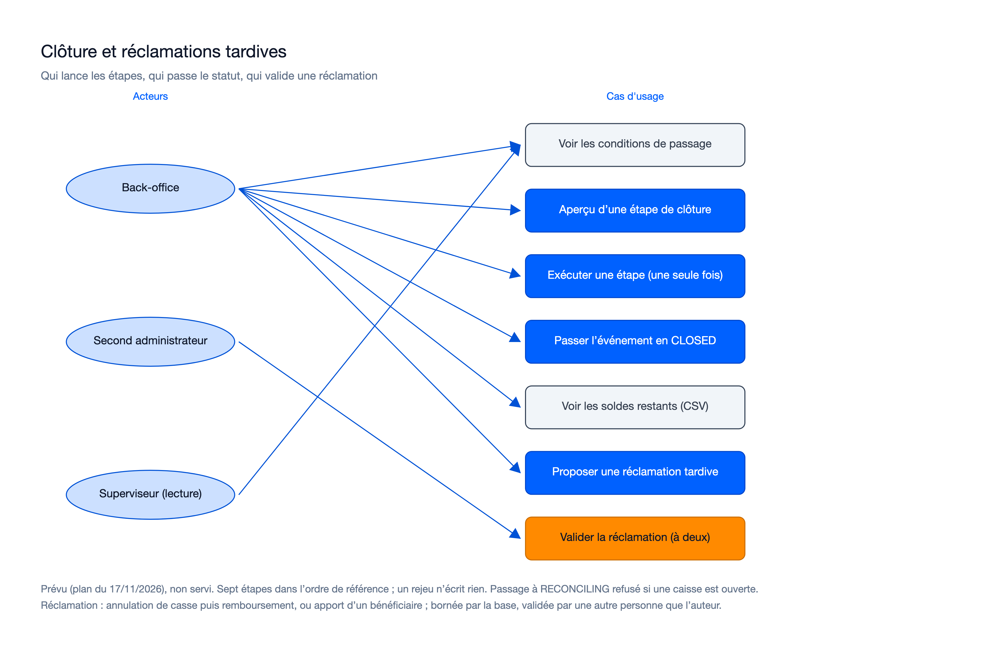
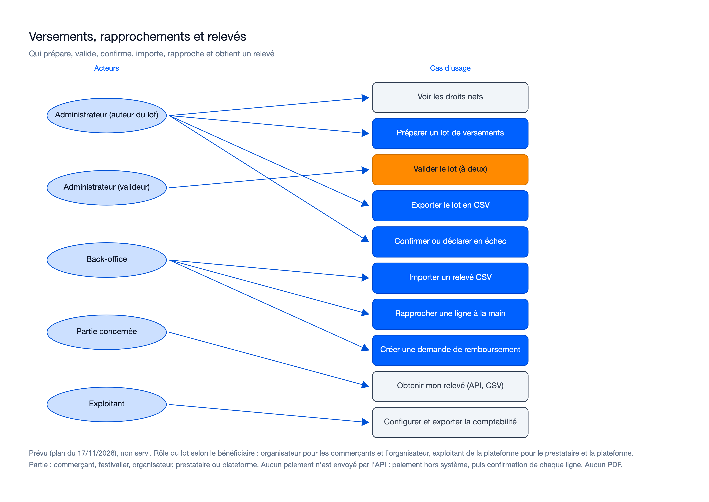

# Cas d'usage : mission versements-rapprochements-cloture-01M7JT4G

> État : **plan finalisé le 17/11/2026, implémentation non commencée** (mission 9b « Versements, rapprochements et clôture »). Rien n'est servi, rien n'est fusionné.
> Source : `spec.md` (7 user stories, 24 FR, 6 NFR, 11 contraintes), `plan.md`, `research.md` (R-01 à R-16), `data-model.md`, `contracts/` et
> `docs/passation-9b/contexte-9b.md` (décisions 1 à 5 du porteur du 17/11/2026). Diagrammes `/illustre` (préférence du porteur du 13/10/2026), police sans empattement,
> rendus relus ; sources et générateur dans [`diagrams/`](diagrams/) (`generate.py`).

## Cas d'usage propres à cette mission

### Clôture et réclamations tardives

Sources : [`usecase-cloture.excalidraw`](diagrams/usecase-cloture.excalidraw), [`usecase-cloture.svg`](diagrams/usecase-cloture.svg).

### Versements, rapprochements et relevés

Sources : [`usecase-versements.excalidraw`](diagrams/usecase-versements.excalidraw), [`usecase-versements.svg`](diagrams/usecase-versements.svg).

| Cas d'usage | Acteur | Règle principale (prévue) | Route (ajoutée au contrat, non servie) |
|---|---|---|---|
| Voir les conditions de passage | Back-office, superviseur (lecture) | Liste des conditions de chaque statut et leur état ; passage refusé tant qu'une manque (FR-001) ; caisse ouverte bloque `RECONCILING` (FR-002) | `POST …/status-transitions` (existante), `GET …/closing-steps` (`listEventClosingSteps`) |
| Aperçu d'une étape de clôture | Back-office (`ORGANIZER_ADMIN`, `OPERATOR_ADMIN`) | Calcul des montants sans rien écrire ; sept étapes : droits de place, frais du prestataire, redevance, régularisation `NET_OF_REFUNDS`, casse, cautions acquises, crédits offerts expirés | `GET …/closing-steps/{step}/preview` (`previewEventClosingStep`) |
| Exécuter une étape | Back-office | Refusée si une étape précédente manque (`409 CLOSING_CONDITION_NOT_MET`) ; une seule écriture par étape, rejeu sans effet, 50 exécutions concurrentes sans doublon (NFR-001) | `POST …/closing-steps/{step}` (`executeEventClosingStep`) |
| Passer l'événement en `CLOSED` | Back-office | Grands livres `LOCKED` si positions soldées, sinon `CLOSING` avec relevé des soldes restants ; échéance de remboursement exigée | `POST …/status-transitions` (existante) |
| Voir les soldes restants | Back-office | JSON ou CSV | `GET …/remaining-balances` (`getEventRemainingBalances`) |
| Proposer, puis valider une réclamation tardive | Back-office auteur, second administrateur | Annulation de casse puis remboursement (`postLateClaim`, au contrat) ou apport d'un bénéficiaire (`ADJUSTMENT`, ajouté) ; bornées par `check_late_claim` ; valideur distinct de l'auteur | `POST /ledgers/{id}/late-claims` (existante), `POST /ledgers/{id}/late-adjustments` (`postLateAdjustment`) |
| Voir les droits nets | Administrateur | Droit net par partie moins les versements en cours | `GET /ledgers/{id}/payout-entitlements` |
| Préparer un lot de versements | Administrateur auteur | Montant de chaque ligne borné par le droit net (`CL055` à la validation) ; rôle selon le bénéficiaire : `ORGANIZER_ADMIN` (commerçants, organisateur), `OPERATOR_ADMIN` (prestataire, plateforme) | `POST /ledgers/{id}/payout-batches/approval-requests` (`requestPayoutBatch`, `202`) |
| Valider le lot | Administrateur valideur, distinct | Action `PAYOUT` existante ; écrit `PAYOUT_INITIATED` et gèle les montants ; l'auteur est refusé | `POST /approval-requests/{id}/approve` (existante) |
| Exporter le lot | Administrateur | CSV : bénéficiaire, moyen, numéro ou IBAN, montant, référence ; non rejoué | `GET …/payout-batches/{id}/export` |
| Confirmer ou déclarer en échec | Administrateur | `CONFIRMED` avec référence ou `FAILED` avec motif (droit recrédité) ; une seule transition par ligne ; alerte au-delà de 48 h en `INITIATED` | `POST /payouts/{id}/confirm` ; `GET /ledgers/{id}/payouts` |
| Importer un relevé | Back-office | CSV par compte `A-*`, sans doublon au réimport, devise ou compte étranger refusés ; 10 000 lignes en moins de 60 s (NFR-003) | `POST /ledgers/{id}/accounts/{account_id}/statements` |
| Rapprocher une ligne | Back-office | Automatique par référence des tables sources, puis à la main ; même prestataire, grand livre et compte ; anomalies PSP ouvertes représentées dans l'écart (OP-N82) | `GET …/statement-lines`, `POST /statement-lines/{id}/match`, `GET …/reconciliation` |
| Créer une demande de remboursement | Back-office | `BANK_TRANSFER` avec IBAN validé (`422` sinon) ; `requested_by` renseigné ; suit le circuit à deux de la 9a (OP-N123) | `POST /refund-requests` (`createRefundRequest`) |
| Obtenir son relevé | Commerçant, festivalier, organisateur, prestataire, plateforme | Limité à son périmètre ; API et CSV, pas de PDF | `GET …/statements/{party_kind}`, `GET /me/wallets/{id}/statement` |
| Configurer et exporter la comptabilité | Exploitant | Correspondance versionnée jamais codée en dur, types non mappés signalés (`X-Unmapped-Count`) ; exemple SYSCOHADA indicatif (OP-N3) | `GET/POST …/account-mappings`, `GET …/accounting-exports` |

Dettes de la 9a levées par cette mission : OP-N123 (virement créé par le back-office), OP-N124 (code du titulaire consommé seulement si la décision est écrite), OP-N126 (recrédit d'un `FAILED` borné par le rapprochement ou un second valideur), OP-N128 (`approved_by` sur la caution, cumul sous verrou), OP-N130 (transitions de `refund_request` gardées par la base).

Hors périmètre : aucun envoi de paiement par l'API (paiement manuel, C-003), aucun PDF, adaptateurs réels de relevés et d'alertes (mission 12b).

## Lien avec la synthèse globale

Contribue à : `docs/02-use-case-diagram.md`, domaines « Argent réel : PSP, caisses, rapprochements, versements » (versements, rapprochements, relevés, demande de remboursement du back-office) et « Clôture d'un événement » si ce domaine existe au diagramme global, sinon « Administration et exploitation » (étapes de clôture, réclamations tardives, comptabilité). Pas de renommage ni de fusion de cas d'usage globaux.

## Nécessaire pour cette mission ? Oui : onze acteurs-rôles et seize cas d'usage nouveaux, deux diagrammes générés et relus (réponse proposée par l'Agent le 17/11/2026, en attente de confirmation du porteur).
## Complet ? Oui pour le plan : relevé du scellement, des alertes et des contrôles permanents traité en séquence (pas de cas d'usage utilisateur) ; à recaler sur le code à la review (proposition de l'Agent, en attente de confirmation du porteur).
## Validé par : réponse proposée par l'Agent le 17/11/2026, en attente de confirmation du porteur.
