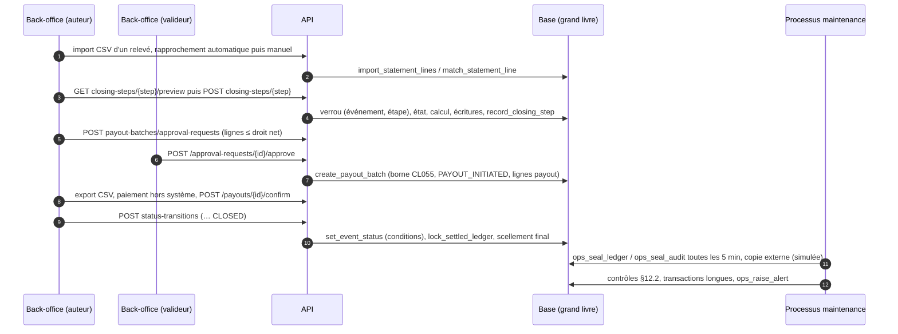

# Implementation Plan: Versements, rapprochements et clôture

**Branch**: `feat/versements-rapprochements-cloture` | **Date**: 2026-11-17 | **Spec**: [spec.md](spec.md)
**Input**: Mission specification from `kitty-specs/versements-rapprochements-cloture-01M7JT4G/spec.md`

## Summary

Finir le cycle de l'argent d'un événement. La base porte déjà les règles de statut, le verrouillage, les réclamations
tardives et le scellement. Les constructeurs d'écritures de clôture existent mais ne sont appelés par personne. La
mission ajoute :

- **Clôture** : sept étapes ordonnées avec aperçu puis exécution, une seule fois chacune (table `closing_step`) ; trois
  conditions de passage nouvelles (caisse ouverte, échéance de remboursement, étapes faites) ; `PSP_RECONCILED`
  calculée.
- **Versements** :
  - un lot = une demande d'approbation `PAYOUT`, préparée par un administrateur et validée par un second, avec le rôle
    selon le bénéficiaire ;
  - borne « montant ≤ droit net » en base ;
  - export CSV ;
  - résultat ligne par ligne.
- **Rapprochement** : import CSV par compte d'argent, rapprochement automatique par les références des tables sources,
  puis manuel ; compte rapproché quand le solde du relevé concorde ; anomalies PSP représentées.
- **Réclamations tardives** : `postLateClaim` du contrat et l'apport `ADJUSTMENT`, à deux.
- **Dettes de la 9a** : demande de remboursement du back-office (`BANK_TRANSFER`, OP-N123), OP-N124, OP-N126, OP-N128 et
  OP-N130.
- **Exploitation** :
  - scellement toutes les 5 min (grand livre et audit) avec copie externe simulée, refusée en production ;
  - vérification quotidienne ;
  - contrôles permanents ;
  - transactions longues ;
  - alertes par audit, journal et notification.
- **Relevés** des parties (API et CSV) et export comptable par correspondance versionnée.

Les ajouts au contrat sont listés dans [`contracts/contract-additions.md`](contracts/contract-additions.md) et **validés
par le porteur avant toute implémentation** (C-002). Paiement manuel (C-003).

## Technical Context

**Language/Version**: TypeScript 5.9.3, Node.js 22 LTS (`engines: >=22 <23`), SQL PostgreSQL 17
**Primary Dependencies**: NestJS 11, `pg`, déjà épinglés (`docs/08-pile-logicielle.md`). Aucune dépendance nouvelle :
CSV, IBAN et copie simulée sans bibliothèque (R-15, ADR-78 ; DIRECTIVE_051 sans objet).
**Storage**: PostgreSQL 17 au central ; migrations `0083` et suivantes ; nouvelle section de `post-roles.sql` ; schéma de
référence et `.sql` générés intouchés.
**Testing**: pgTAP (gardes, droits par rôle, bornes, transitions, égalité des deux copies des conditions) ; Jest
intégration sur base recréée (routes, circuit à deux, scénario de référence de bout en bout, concurrence) ; Jest
unitaire (calculs, CSV, IBAN, garde de production) ; mesures NFR-003 et NFR-004 dans des suites isolées
(`SKIP_LATENCY`).
**Target Platform**: API centrale (processus `api`) et processus `maintenance` (Linux) ; CI GitHub Actions ; preuves
locales sur macOS.
**Project Type**: monorepo npm (`apps/`, `packages/`).
**Performance Goals**:
- import et rapprochement automatique de 10 000 lignes en moins de 60 s (NFR-003) ;
- 95 % des aperçus, listes et relevés en moins de 1 s sur 100 000 transactions (NFR-004) ;
- aucune écriture non scellée plus de 10 min (NFR-005) ;
- alerte en une période de contrôle (NFR-006).

**Constraints**:
- C-001 à C-011 de la spec ;
- un rôle par processus ; `cashless_maint` sans lecture de table ;
- écarts de sécurité soumis avant d'être codés.

**Scale/Scope**: 24 FR, 6 NFR, 11 contraintes ; 20 opérations ajoutées au contrat, 1 servie telle quelle
(`postLateClaim`) ; 7 étapes de clôture ; 9 travailleurs de maintenance.

## Charter Check

Pas de charte (`.kittify/charter/charter.yaml` absent) : contrôle sans objet. Les règles qui en tiennent lieu sont
`CLAUDE.md` (écarts de sécurité, aucun faux en production, dette nommée, revue) et SPECIFICATION §0.3.

### Décisions du porteur du 17/11/2026

- **Au specify** :
  - mission entière ;
  - ajouts au contrat listés au plan ;
  - relevés importés en CSV ;
  - lot préparé par un administrateur, validé par un second ;
  - étapes de clôture par action avec aperçu ;
  - copie externe des scellements simulée jusqu'à la 12b ;
  - relevés par API et CSV.
- **Au plan** :
  - rôle du versement selon le bénéficiaire (SPECIFICATION §3.2 amendée) ;
  - transactions longues par fonction dédiée sans texte de requête ;
  - alertes par audit, journal et notification, envoi réel en 12b ;
  - `postLateClaim` plus `ADJUSTMENT` ajouté.

### Écarts de sécurité

**Écarts acceptés par le porteur**, à consigner (OP + ADR + test qui échoue si la limite s'élargit + report PRD et
PROMPTS) :

- copie externe des scellements simulée, refusée en production, levée en 12b (C-006) ;
- alertes sans envoi à une personne, levée en 12b (C-010).

**Renforcements**, qui se font puis se consignent :

- borne du droit net en base (R-07) ;
- droits réduits sur `payout` et `external_statement_line`, aujourd'hui modifiables en entier par `cashless_app` ;
- garde de portée sur les lignes de relevé ;
- `refund_deadline` exigée avant `CLOSED` ;
- caisse ouverte bloquant `RECONCILING` ;
- étapes de clôture exigées ;
- transitions de `refund_request` gardées par la base (OP-N130).

**Élargissements de droits nécessaires à la fonction**, bornés et testés :

- fonctions `ops_*` exécutables par `cashless_maint` seul, sans lecture de table ;
- fonction de transactions longues dont le propriétaire lit `pg_stat_activity` sans texte de requête (C-011).

**À faire relire par une personne** :

- toutes les migrations de la mission ;
- la nouvelle section de `post-roles.sql` ;
- `create_payout_batch`, `settle_payout`, `import_statement_lines`, `match_statement_line` ;
- les fonctions `ops_*` ;
- `isValidIban` ;
- l'écriture CSV (anti-injection).

## Project Structure

### Documentation (this mission)

```
kitty-specs/versements-rapprochements-cloture-01M7JT4G/
├── spec.md
├── plan.md                      # ce fichier
├── research.md                  # décisions R-01 à R-16, contradictions signalées
├── data-model.md                # tables, colonnes ajoutées, fonctions, invariants, graphe de refund_request
├── quickstart.md                # parcours de vérification locale
├── contracts/
│   ├── contract-additions.md    # LISTE À VALIDER PAR LE PORTEUR (routes, schémas, codes)
│   └── interfaces.md            # objets partagés entre lots, propriétaires, codes d'alarme, ordre des verrous
├── checklists/requirements.md
└── decisions/
```

### Source Code (repository root)

```
packages/contracts/openapi.yaml               # ajouts seulement (contract-additions.md), types régénérés TS et Dart
packages/ledger-sql/
├── migrations/0083_statements.sql                  # statement_import, external_statement_line, rapprochement
├── migrations/0084_closing_conditions_steps.sql    # set_event_status, event_transition_conditions, closing_step
├── migrations/0085_payouts.sql                     # colonnes payout, create_payout_batch, settle_payout, CL055
├── migrations/0086_refund_debts.sql                # OP-N128 (refund_deposit_for_session), OP-N130 (déclencheur)
├── migrations/0087_ops_functions.sql               # ops_* (scellement, copie, contrôles, alertes, transactions longues)
├── migrations/0088_account_mapping.sql             # account_mapping
├── post-roles.sql                                  # section 12 : droits de la mission
└── tests/tests_*.sql                               # un fichier pgTAP par migration

apps/api/src/
├── closing/            # étapes : contrôleur, service, calculateurs, relevé des soldes restants
├── payouts/            # droits nets, action PAYOUT, export, confirmation
├── reconciliation/     # import CSV, rapprochement, état par compte
├── late-claims/        # actions LATE_CLAIM et ADJUSTMENT, routes
├── refunds/            # createRefundRequest (back-office), OP-N124, OP-N126
├── media/lifecycle/    # release.service.ts (OP-N128)
├── sealing/            # port, faux, travailleurs de scellement et de vérification
├── processes/          # ops-alerts, travailleurs de contrôle, lecture d'alarm() en boucle (bootstrap.ts)
├── statements/         # relevés des parties, export comptable, account_mapping
├── common/csv.ts, common/iban.ts
└── events/status/      # nouveaux codes de condition et textes

apps/api/test/
├── integration/{closing,payouts,reconciliation,late-claims,statements,sealing}/…
├── integration/refunds/… (tests de borne inversés)
├── scenario/closing-journey.spec.ts     # scénario de référence de bout en bout (SC-001)
└── unit/…
```

**Structure Decision** : monorepo existant (C-009). Chaque lot déclare ses chemins réels.

### Architecture



## Complexity Tracking

| Écart ou complexité | Pourquoi | Alternative plus simple écartée |
|---|---|---|
| Table `closing_step` et verrou par (événement, étape) | Un rejeu recalculerait d'autres montants et le moteur répondrait `CL002` au lieu d'un rejeu sans effet ; il faut aussi tenir 50 exécutions concurrentes | Clé d'en-tête seule (deux clés = deux exécutions) |
| Borne du droit net en fonction SQL | La SPEC exige que le montant ne dépasse pas le droit net ; une borne en API seule affaiblirait le contrôle | Contrôle dans le service seulement |
| Deux copies des conditions de statut (`set_event_status`, `event_transition_conditions`) redéfinies ensemble | Existant ; l'une écrit, l'autre affiche | Les fusionner (changement plus large du schéma de référence) |
| Fonctions `ops_*` | `cashless_maint` ne lit aucune table ; il doit sceller et contrôler tous les prestataires | Donner `SELECT` sur le grand livre au rôle (élargissement) |

## Implementation Concern Map

Les préoccupations ne sont pas des lots. `/spec-kitty.tasks` les traduit.

### IC-00 — Ajouts au contrat

- **Purpose** : écrire dans `openapi.yaml` exactement la liste validée de `contract-additions.md`, et régénérer les types
  TS et Dart.
- **Relevant requirements** : C-002 ; toutes les FR qui ont une route.
- **Affected surfaces** : `packages/contracts/openapi.yaml`, `packages/contracts/generated/*`, `packages/contracts/dart/*`,
  `apps/api/src/errors/sqlstate-map.ts` (`CL055`).
- **Sequencing/depends-on** : validation du porteur ; premier lot.
- **Risks** :
  - un modèle `oneOf` de `$ref` casse la génération Dart ;
  - `npm run check -w @cashless/contracts` doit passer ;
  - test : aucune opération ni valeur existante modifiée, par diff des `operationId` et enums avant et après.

### IC-01 — Conditions de passage et état des étapes

- **Purpose** : migration `0084` (conditions `NO_OPEN_CASH_SESSION`, `REFUND_DEADLINE_REACHED`, `CLOSING_STEPS_DONE`,
  `PSP_RECONCILED` calculée ; table `closing_step`, `record_closing_step`) ; textes fr/en.
- **Relevant requirements** : FR-001, FR-002, FR-004, FR-008 ; C-004, C-005.
- **Affected surfaces** : migration `0084`, `post-roles.sql`, `tests/tests_closing_conditions.sql`,
  `events/status/status.service.ts` et `status-messages.ts`.
- **Sequencing/depends-on** : IC-00, IC-05 (`account_reconciliation`).
- **Risks** :
  - les deux copies des conditions doivent rester égales (test pgTAP) ;
  - la refonte de `set_event_status` doit garder l'ordre des verrous existant ;
  - à faire relire par une personne.

### IC-02 — Étapes de clôture : calcul, aperçu, exécution, soldes restants

- **Purpose** : servir les routes 1 à 4. Calculateurs des sept étapes (R-03, R-04), exécution par le moteur avec clés
  déterministes, état lu avant calcul, verrou par étape, audit, relevé des soldes restants.
- **Relevant requirements** : FR-003 à FR-008, FR-024 ; NFR-001, NFR-002, NFR-004.
- **Affected surfaces** : `apps/api/src/closing/*`, `ledger/types.ts` (destination de casse `OPERATOR`, contradiction 4
  de `research.md`) ; tests d'intégration et scénario de bout en bout.
- **Sequencing/depends-on** : IC-01.
- **Risks** :
  - assiettes des frais (recharges payées, supports activés) à recouper avec le scénario ;
  - régularisation non linéaire ;
  - `forfeit_deposit` un support à la fois, à lancer en série sous le verrou de l'étape ;
  - grand livre à portée `ORGANIZER`.

### IC-03 — Versements

- **Purpose** : migration `0085` (colonnes de `payout`, droits réduits, déclencheur, `create_payout_batch` avec borne
  `CL055`, `settle_payout`) ; droits nets ; action `PAYOUT` (rôle selon le bénéficiaire) ; routes 5 à 9 ; CSV commun.
- **Relevant requirements** : FR-009 à FR-012, FR-024 ; NFR-001 ; SC-002.
- **Affected surfaces** : migration `0085`, `post-roles.sql`, `apps/api/src/payouts/*`, `common/csv.ts`.
- **Sequencing/depends-on** : IC-00.
- **Risks** :
  - droit net relu sous verrou à l'exécution (le droit a pu baisser) ;
  - ordre des verrous des comptes ;
  - destination (numéro, IBAN) : donnée personnelle, masquée hors du CSV ;
  - à faire relire par une personne.

### IC-04 — Réclamations tardives

- **Purpose** : actions `LATE_CLAIM` (`postLateClaim`) et `ADJUSTMENT` (`postLateAdjustment`), sur le modèle de
  `LATE_CHARGEBACK`.
- **Relevant requirements** : FR-016, FR-024.
- **Affected surfaces** : `apps/api/src/late-claims/*`, `ledger/builders/festival/refund.ts` (`moneyAccountFor`).
- **Sequencing/depends-on** : IC-00, IC-06 (`moneyAccountFor` étendu).
- **Risks** :
  - deux écritures sous un point de sauvegarde ;
  - preuve du droit contrôlée par l'API ;
  - `CASH` sans caisse refusé.

### IC-05 — Import et rapprochement des relevés

- **Purpose** : migration `0083` (`statement_import`, colonnes, garde de portée, droits, `import_statement_lines`,
  `match_statement_line`, `account_reconciliation`) ; routes 10 à 13 ; anomalies PSP représentées.
- **Relevant requirements** : FR-013 à FR-015, FR-024 ; NFR-003 ; SC-003.
- **Affected surfaces** : migration `0083`, `post-roles.sql`, `apps/api/src/reconciliation/*`.
- **Sequencing/depends-on** : IC-00, IC-03 (lien `payout.settled_tx_id`).
- **Risks** :
  - performance de l'import de 10 000 lignes (jointures sur les tables sources) ;
  - signe des montants (entrée ou sortie) à fixer dans le format ;
  - à faire relire par une personne.

### IC-06 — Demande de remboursement du back-office (OP-N123)

- **Purpose** : route `createRefundRequest`, `BANK_TRANSFER` avec IBAN validé, `requested_by` écrit,
  `moneyAccountFor(BANK_TRANSFER)`.
- **Relevant requirements** : FR-017.
- **Affected surfaces** : `apps/api/src/refunds/*`, `common/iban.ts`, `ledger/builders/festival/refund.ts`.
- **Sequencing/depends-on** : IC-00.
- **Risks** :
  - la création par l'app garde son refus de `BANK_TRANSFER` ;
  - IBAN masqué dans l'audit.

### IC-07 — Limites de la 9a (OP-N124, OP-N126, OP-N128, OP-N130)

- **Purpose** : migration `0086` (déclencheur de `refund_request`, `refund_deposit_for_session` avec valideur) ;
  vérification du code scindée ; recrédit d'un `FAILED` borné ; cumul du guichet sous verrou des portefeuilles.
- **Relevant requirements** : FR-018, FR-019.
- **Affected surfaces** : migration `0086`, `post-roles.sql`, `customer-auth.service.ts`, `holder-challenge.service.ts`,
  `refund-confirm.service.ts`, `release.service.ts`, tests de borne (`journey-limits.spec.ts`, `journey.spec.ts`,
  `tests_refund_requests.sql`).
- **Sequencing/depends-on** : IC-05 (OP-N126 lit le rapprochement), IC-06 (création directe en `REQUESTED`).
- **Risks** :
  - fichiers sensibles déjà relus en 9a, à faire relire de nouveau ;
  - chaque levée met à jour son OP et son ADR.

### IC-08 — Scellement, contrôles permanents, transactions longues, alertes

- **Purpose** : migration `0087` (`ops_*`) ; port et faux de copie externe (refus en production) ; travailleurs
  `ledger-seal`, `audit-seal`, `seal-verify`, `ledger-controls`, `payout-overdue`, `statement-unmatched`,
  `open-anomalies`, `long-transactions` ; `ops_raise_alert` ; lecture d'`alarm()` par la boucle continue.
- **Relevant requirements** : FR-020, FR-021 ; NFR-005, NFR-006 ; SC-004, SC-005 ; C-005, C-006, C-010, C-011.
- **Affected surfaces** : migration `0087`, `post-roles.sql`, `apps/api/src/sealing/*`, `processes/*`
  (`bootstrap.ts`, `maintenance.module.ts`), `kms/production-guard.ts` (liste), `test/unit/production-guard.spec.ts`.
- **Sequencing/depends-on** : IC-03 (versements à 48 h), IC-05 (lignes non rapprochées).
- **Risks** :
  - coût des contrôles sur gros grands livres (limiter aux `OPEN`/`CLOSING`) ;
  - travailleurs en série dans une boucle ;
  - à faire relire par une personne.

### IC-09 — Relevés des parties et export comptable

- **Purpose** : migration `0088` (`account_mapping`) ; routes 16 à 19 ; CSV ; couples non mappés signalés.
- **Relevant requirements** : FR-022, FR-023 ; NFR-004 ; C-007.
- **Affected surfaces** : migration `0088`, `post-roles.sql`, `apps/api/src/statements/*`.
- **Sequencing/depends-on** : IC-00, IC-02 (`closing_step.summary` pour les relevés de clôture).
- **Risks** :
  - périmètre de chaque partie (`MERCHANT_ADMIN` limité à son commerçant) ;
  - aucun jeu SYSCOHADA définitif (OP-N3).

### IC-10 — Preuves, consignation et documentation

- **Purpose** :
  - scénario de référence de bout en bout (SC-001) ;
  - concurrence (NFR-001) ;
  - mesures (NFR-003, NFR-004) ;
  - matrice d'acceptation ;
  - consignation : OP et ADR des écarts acceptés (copie simulée, alertes), ADR des renforcements, SPECIFICATION §3.2
    amendée, levées OP-N123 à OP-N130, PRD et PROMPTS ;
  - `REPONSE-ENDPOINTS` pour les équipes clientes.
- **Relevant requirements** : NFR-001 à NFR-006, SC-001 à SC-006, C-008.
- **Sequencing/depends-on** : toutes les autres.
- **Risks** : une limite non consignée est un constat bloquant à la revue post-fusion.
